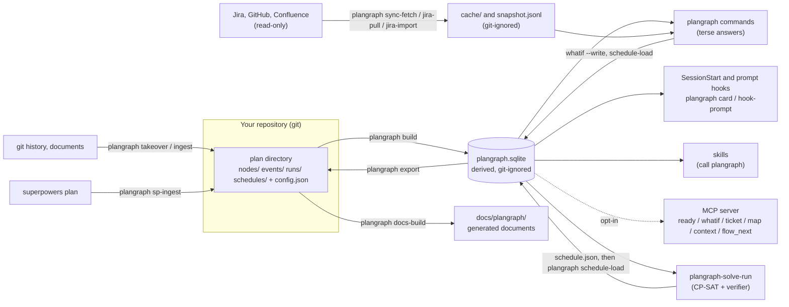

# plangraph

[](https://github.com/jourlez/plangraph/actions/workflows/ci.yml)

plangraph is a Claude Code plugin that keeps a project's plan as a small graph in git: requirements, decisions, tasks and tickets, people, repositories and history, as one small text file per node. It takes over an existing repository (`plangraph takeover`) or starts from one plan document, answers plan questions with one local command that prints a few lines ("can this start?", "who owns this?", "what breaks if it moves to Ben?"), generates documents from the graph, and checks every answer against two exact rules (a handoff rule and a capacity rule). It never calls a model and never writes to Jira, GitHub or Confluence.

Status: 1.0 is in preparation and not released yet. What was verified, and what was not, is listed in [docs/audit/1.0-audit.md](docs/audit/1.0-audit.md) and in [Known limits](#known-limits-and-roadmap). No token or accuracy benefit has been measured (see [Measured results](#measured-results)); nothing here claims one.

## Contents

- [What it does, and what it does not do](#what-it-does-and-what-it-does-not-do)
- [Requirements](#requirements)
- [Installation](#installation)
- [Quickstart](#quickstart)
- [How it works](#how-it-works)
- [What runs on your machine](#what-runs-on-your-machine)
- [Commands](#commands)
- [Skills](#skills)
- [Configuration](#configuration)
- [Works with](#works-with)
- [The solver](#the-solver)
- [Measured results](#measured-results)
- [Security model](#security-model)
- [Quality](#quality)
- [Troubleshooting](#troubleshooting)
- [FAQ](#faq)
- [Known limits and roadmap](#known-limits-and-roadmap)
- [Development](#development)
- [Contributing](#contributing)
- [Security](#security)
- [Changelog](#changelog)
- [License](#license)

## What it does, and what it does not do

What it does:

- Stores the plan as small text files in your repository (`nodes/<kind>/` with one file per ticket, person, sprint, requirement, decision and so on, a line per field, canonical order; `events/`, `runs/` and `schedules/` for append-only batches), so plan changes are reviewed and merged like code with stock git: no merge driver, no setup per clone. `plangraph check` guards what git cannot, and `plangraph resolve` repairs mechanical conflicts.
- Takes over an existing project in one resumable pipeline (`plangraph takeover`): scans repositories, reads history, requirements, ADRs and plan documents, optionally fetches trusted trackers, builds and checks the graph, and ends with a gap report that lists every unknown instead of guessing it.
- Orchestrates work from the graph (`plangraph flow next`, `flow brief`, `flow-claim`, `flow-progress`, `flow-done`): which task can start, a bounded brief for one task, and append-only events with evidence.
- Generates documents from the graph (`plangraph docs-build`, `plangraph docs check`): roadmap, status, requirement trace, architecture, onboarding, decision index, release notes and one page per repository.
- Gives an agent a short overview and one-task digest (`plangraph map`, `plangraph context`) and keeps the index fresh through git hooks and `plangraph refresh`.
- Answers plan questions with the `plangraph` command: ticket details, what a ticket needs, whether it may start, the load of a person or a sprint, the longest chain behind a ticket, and which verdicts are stale.
- Checks a plan, or a proposed move, against the strict handoff rule and the capacity rule, and lists every violation with a fix (`plangraph check`, `plangraph verify`, `plangraph whatif`).
- Finds the smallest set of moves that brings an overloaded person under capacity (`plangraph whatif --relieve`), and every valid slot for one ticket (`plangraph whatif KEY --find`). Both are read-only.
- Computes a schedule with an exact constraint solver (OR-Tools CP-SAT) and rechecks the result with an independent verifier (`plangraph-solve-run`).
- Lists only the readiness verdicts whose inputs changed (plan text, files, Jira, links, producers), so a re-audit covers what changed and nothing else (`plangraph stale`).
- Offers three opt-in injections, all off by default: a short plan card at session start, a prompt hook that adds owner and blockers of a ticket you name, and a read-only MCP server. The skills and the `plangraph` command need none of them.

What it deliberately does not do (decision record: [docs/REUSE.md](docs/REUSE.md)):

- **No Jira writes.** The tool reads Jira only. Comments, transitions and new issues go through the Atlassian connector, and the skills only propose them for the owner to approve.
- **No publishing or sending.** `plangraph report` writes local files. Publishing goes through the Artifact tool, Claude Docs or Confluence; Slack messages are drafts a person sends.
- **No session memory, handoff or code navigation.** OpenWolf owns those, and plangraph only reads its files. Development workflow (brainstorming, plan writing, TDD, review) belongs to the superpowers skills, which plangraph recommends and never starts.
- **No model calls** in the tool itself.

## Requirements

**Supported platforms: macOS and Linux.** Windows is not supported (there is no `O_NOFOLLOW` there, and nothing was run on it). Use WSL at your own risk; it is untested. The Claude Code hooks of the plugin run `node` directly, not a shell script. The optional git hook scripts that `plangraph githooks-install` writes are three-line POSIX `sh` wrappers.

> **Which Node, how to get it.** Node.js 24.15 or newer (the floor; the index uses the built-in `node:sqlite`). Check with `node --version`. If it is older, install a current one with nvm (`nvm install 24`) or fnm (`fnm install 24`). The repository's `.node-version` file holds the Node major that development and CI use; `fnm use` reads it, and with nvm you pass the number yourself (`nvm use 24`).

| Requirement | Version | Needed for |
|---|---|---|
| Node.js | 24.15 or newer (the index uses the built-in `node:sqlite`) | everything |
| git | any recent version | the data, history, stale detection |
| Claude Code | 2.1.329 or newer (`engines.claude-code` is `>=2.1.329` in `plugin.json`) | the plugin: hooks, skills, `plangraph` on the Bash PATH |
| Python 3 with OR-Tools, installed through uv (recommended: uv installs pinned, hash-verified packages on the first run), or a Python 3.10 to 3.14 | OR-Tools has no wheel for Python 3.15 yet | the scheduling solver only (`plangraph-solve-run`); everything else works without it |
| `gh`, signed in | any recent version | optional: `plangraph sync-fetch` reads GitHub with your own token |

In short: Node 24.15 or newer, git, and Claude Code 2.1.329 or newer. (`engines.node` is `>=24.15` in `package.json`.) The plugin was installed and run on Claude Code 2.1.329; releases after 2.1.329 have not been tested. There are no runtime npm dependencies.

**Telemetry: none.** plangraph collects and sends nothing about you or your project. This was checked by searching the code (`src/`, `lib/`, `bin/`, `mcp/`, `hooks/`) for network access: the only HTTP client is `lib/jira/client.ts` (read-only Atlassian requests, run only by `jira-pull`, `jira-text` and `sync-fetch` for a Jira target you named in `config.json` and trusted with `plangraph trust`), GitHub is read through your own `gh` by `sync-fetch` the same way, and the solver's first run downloads pinned packages through uv. Nothing else opens a socket. The check is a search of the source, not a network capture; see [docs/audit/1.0-audit.md](docs/audit/1.0-audit.md).

## Installation

### From GitHub, inside Claude Code

```text
/plugin marketplace add jourlez/plangraph
/plugin install plangraph@plangraph-marketplace
```

Restart Claude Code to load the hook, the skills and the commands.

The same steps from a terminal, with the `claude plugin` CLI:

```bash
claude plugin marketplace add jourlez/plangraph
claude plugin install plangraph@plangraph-marketplace
```

Add `--scope project` or `--scope local` to `claude plugin install` to install for one project instead of for your user (the default scope is `user`).

### From a local path

Clone the repository, then add the folder as a marketplace from its local path:

```bash
git clone https://github.com/jourlez/plangraph.git
claude plugin marketplace add ./plangraph
claude plugin install plangraph@plangraph-marketplace
```

Inside Claude Code the equivalent is `/plugin marketplace add <path to the clone>`, then the same `/plugin install` command.

### Updating

```bash
claude plugin marketplace update plangraph-marketplace
claude plugin update plangraph@plangraph-marketplace
```

Restart Claude Code to apply the update. A plan directory written by a pre-1.0 version is refused with the line `unsupported pre-1.0 directory: recreate it with plangraph takeover`.

### Uninstalling

```bash
claude plugin uninstall plangraph@plangraph-marketplace
claude plugin marketplace remove plangraph-marketplace
```

`--keep-data` on `uninstall` keeps the plugin's data directory. Your plan data stays in your repository: the plan directory (`.plangraph/` by default) is plain text that you own.

To remove what plangraph added to a repository, run `plangraph uninstall` first: it removes the `.githooks/` scripts it wrote (if you did not edit them) and the `.gitignore` lines it added, and, after you confirm with `--yes` or a typed `y`, the local cache and the index. It never deletes `nodes/`, `events/`, `runs/`, `schedules/`, `config.json` or `format.json`; delete the plan directory yourself if you want the plan gone. To remove one person's data from the plan and its history, see [docs/ERASURE.md](docs/ERASURE.md).

### Turning the card, the prompt hook and the MCP server on

No token or accuracy benefit has been measured; the default injections were measured and found not to help on a small plan (see [Measured results](#measured-results)). So all three are off by default. The skills and the `plangraph` command (`plangraph map`, `plangraph context`) work without them.

The plugin declares three options:

| Option | Values | Default | What `on` does |
|---|---|---|---|
| `card` | `auto`, `off` | `off` | `auto` injects the short plan card at session start (and runs the quiet refresh) |
| `prompt_hook` | `on`, `off` | `off` | `on` adds owner and blockers of a ticket named in your prompt (UserPromptSubmit). The hook stays registered; with the option off it exits silently at once |
| `mcp` | `on`, `off` | `off` | `on` starts the read-only MCP server |

- Inside Claude Code: `/plugin configure plangraph@plangraph-marketplace`.
- At install time: `claude plugin install plangraph@plangraph-marketplace --config card=auto --config prompt_hook=on --config mcp=on`.
- Later, from a terminal: `echo '{"card":"auto","prompt_hook":"on","mcp":"on"}' | claude plugin configure plangraph@plangraph-marketplace --values-stdin`. Use `off` to turn one back off (`--config card=off`).
- For one shell or one machine: `PLANGRAPH_CARD=auto` (or `PLANGRAPH_CARD=off`; unset also means off), `PLANGRAPH_PROMPT_HOOK=on`, `PLANGRAPH_MCP=on`. The three are strictly opt-in: only the explicit value turns one on, and the code does not rely on Claude Code exporting the default. Claude Code exports the plugin options as `CLAUDE_PLUGIN_OPTION_CARD` and `CLAUDE_PLUGIN_OPTION_PROMPT_HOOK`.

### Verifying the install

1. Run `/plugin` in Claude Code (or `claude plugin list` in a terminal). `plangraph@plangraph-marketplace` should be listed as enabled. `claude plugin details plangraph` lists the skills, the two hooks and the MCP server (this count was last checked on Claude Code 2.1.329 for the 0.5.0 plugin, not for 1.0).
2. In a Claude Code session, ask Claude to run `plangraph explain`. It prints the command list. `plangraph` is on the Bash PATH only inside Claude Code sessions with the plugin enabled; see [Troubleshooting](#troubleshooting) for terminal use.
3. In a project, run `plangraph doctor`. It checks Node, the data format and the solver runtime, and exits 0 when all are fine.

The GitHub and local-path installs, `configure`, `update`, `uninstall` and `marketplace remove` above were run with the `claude plugin` CLI of Claude Code 2.1.329 in an isolated configuration. The interactive `/plugin` menu was not exercised for this README.

Adopting it in another project takes one install and one pasted prompt: see [docs/ADOPT.md](docs/ADOPT.md).

## Quickstart

Two ways in. Both are short here; [docs/GETTING-STARTED.md](docs/GETTING-STARTED.md) walks the first one end to end.

- **An existing project** (a repository with history, documents and maybe a tracker): run `plangraph takeover` and read the gap report. Its commands, output and prose are in [docs/GETTING-STARTED.md](docs/GETTING-STARTED.md).
- **A new plan from one document**: below.

Every command marked `# runs` in this README and in the getting-started guide is executed by `test/docs-examples.test.ts` in a temp copy of a small synthetic project (a git repository `widgets` with three commits, two authors and one plan document), and its output is compared with the block that follows. Inside Claude Code you normally ask in plain words and Claude runs these commands for you; the `/plangraph:init` skill wraps `plangraph init`.

### A new plan in five minutes

The plan document is a superpowers-style implementation plan: `### Task N:` headings, a `Points:` line, a `Files:` list and an `Interfaces:` block that names what each task consumes and produces. Three tasks: a CSV formatter (task 1), an export query (task 2) and an HTTP handler that needs both (task 3).

1. Create the plan directory in your repository:

```bash
plangraph init   # runs
```

```text
initialised .plangraph: edit config.json, then fill the plan with `plangraph takeover` (an existing project) or `plangraph sp-ingest PLAN` (a plan document), then `plangraph build`
suggested lines for this repo's CLAUDE.md (printed only, nothing written):
## Plan questions
Use `plangraph` for plan questions (ticket, ready, whatif, blockers, sprint, person); do not read .plangraph/*.jsonl or the index.
Run `plangraph explain` for the full command list.
```

   It writes `config.json`, `format.json` (format 2, entity storage), the generic learnings and a `.gitignore` for the cache, the index and the staging directory. It writes no `.gitattributes`, no git config and no CLAUDE.md (it prints the lines to add). Use `.plangraphrc` (`{"dir": "docs/plan-graph"}`) for another directory.

2. Ingest the plan document. `--owner` and `--sprint` place the tasks that have no slot yet:

```bash
plangraph sp-ingest docs/superpowers/plans/2026-01-05-widget-export.md --owner Ana --sprint 1   # runs
```

```text
ingested sp:2026-01-05-widget-export: 3 tasks, 2 edges, 0 findings, 0 statuses from ledger (no ledger found: no impl_status set; plan checkboxes are never read as progress); scheduled 3 tasks
warning: seeded 3 tasks for Ana in sprint 1: 7 story points (capacity is not checked here)
```

   The ingest wrote one epic ticket and one ticket per task under `nodes/ticket/`, the two `needs` links of task 3 as `links` lines on that ticket, and a schedule version under `schedules/`. An edge means "consumer needs producer". From Jira, `plangraph jira-pull` or `plangraph jira-import` produce a snapshot (see [Works with](#works-with)); for a whole existing project, use `plangraph takeover`.

3. Build the index and check the plan:

```bash
plangraph build   # runs
```

```text
built .plangraph/plangraph.sqlite: 4 tickets, 2 links, 0 evidence rows, 0 findings, 16 learnings
```

```bash
plangraph check   # runs
```

```text
tickets 3 | links 2 | strict-rule violations 0 | person-sprints over cap 0 | loop-free true | last sprint 1
```

```bash
plangraph verify   # runs
```

```text
OK plan valid (4 tickets)
```

   `check` and `verify` exit 1 on a violation. `verify` is a second, independent implementation of the same rules. The index holds 4 tickets (the epic and three tasks); `check` counts the 3 that are placed in a sprint.

4. See what Claude sees at session start, and ask the common questions:

```bash
plangraph card   # runs
```

```text
plangraph 6736076e | 4 tickets, 2 links, S1-S1, 1 person
verdicts: <untrusted n="cd74b53e">4 unrated</untrusted>
over cap: none
plan questions: use plangraph (ticket, ready, whatif, blockers, sprint, person); do not read .plangraph/*.jsonl
```

```bash
plangraph ready sp:2026-01-05-widget-export/3   # runs exit 1
```

```text
NOT READY sp:2026-01-05-widget-export/3
- waits for sp:2026-01-05-widget-export/1 (impl_status todo, planned S1 Ana)
- waits for sp:2026-01-05-widget-export/2 (impl_status todo, planned S1 Ana)
(statuses as of the last build: pass --jira snapshot.json for live ones)
```

```bash
plangraph map   # runs
```

```text
plangraph map | 4 tickets, 0 repos, 1 person
owners: Ana 3
epics: sp:2026-01-05-widget-export 0/3
fresh: index 6736076e, cache age unknown
```

   Text that comes from your data is printed inside `<untrusted>` fences, so the model treats it as data.

5. Test a move before making it. Every `whatif` is a dry run that changes nothing:

```bash
plangraph whatif sp:2026-01-05-widget-export/1 --sprint 2   # runs exit 1
```

```text
NO: sp:2026-01-05-widget-export/1 -> Ana S2. CONSUMER_EARLY sp:2026-01-05-widget-export/3 (S1 Ana, needs S2). Fix: keep S2 (1 other shifts, 0 owner changes). touches: plan docs/superpowers/plans/2026-01-05-widget-export.m~
```

```bash
plangraph whatif sp:2026-01-05-widget-export/3 --sprint 2   # runs
```

```text
OK: sp:2026-01-05-widget-export/3 -> Ana S2. Ana S2 2/40. Frees 2 on Ana S1. touches: plan docs/superpowers/plans/2026-01-05-widget-export.m~
```

   Moving the formatter (task 1) to sprint 2 is refused, because task 3 needs it and stays in sprint 1. Moving the handler (task 3, which nothing needs) is fine.

6. Commit the text files (`git add .plangraph`). The index `plangraph.sqlite` and the cache are git-ignored and rebuilt by `plangraph build`.

7. Check the setup and the companion tools with `plangraph doctor` (data format, Node version, solver runtime) and `plangraph integrations` (which of superpowers, OpenWolf, context7 and the rest are present). Their output depends on the machine, so the tests do not run them.

8. Keep the index fresh and see what else is there: `plangraph githooks-install` writes git hooks that run `plangraph refresh --fast --quiet`; `plangraph docs-build` writes the generated documents; `plangraph flow next` lists the tasks that can start. See [docs/GETTING-STARTED.md](docs/GETTING-STARTED.md).

### Merging and re-auditing

**A fresh clone.** Nothing to set up: the plan is plain files and stock git merges them. Run `plangraph build` to make the index. After a merge, run `plangraph check`; if git left conflict markers in a plan file, `plangraph resolve` repairs the mechanical cases and `plangraph check` names the rest by file and line.

**Incremental re-audit.** `plangraph refs-update` records the inputs of each audited verdict (here, the plan task sections of an ingested superpowers plan). After the plan text changes, `plangraph stale --list` names exactly the verdicts to redo, and the `plangraph:audit` skill prepares agent work units for only those tickets and shows the cost before anything is spent. Add `--jira snapshot.jsonl` to include Jira changes.

## How it works

### Data model

- **Text in git is the source of truth.** The plan directory holds one `.pg` file per node under `nodes/` (tickets, people, sprints, epics, repos, open items), append-only batch files under `events/` and `runs/`, immutable schedule versions under `schedules/`, and `config.json`, `format.json`, `meta.jsonl`, optional `history.jsonl` and `actuals.jsonl`. Each file is canonical: sorted lines, fixed spelling, trailing newline. Unknown fields are kept, never interpreted. The index, the observation cache and the solver input are derived and git-ignored. Details: [docs/FORMAT.md](docs/FORMAT.md).
- **The SQLite index is a throwaway derived file.** `plangraph build` writes `plangraph.sqlite` atomically and records a fingerprint of the text it was built from and a digest of its own rows. When the text changes, queries still answer but say `STALE`; `plangraph build` rebuilds it in well under a second on a plan of about 1,400 tickets. The index is git-ignored.
- **Merging.** There is no merge driver: git merges the files as text. Two branches that edit different nodes, or non-adjacent fields of one node, merge clean; adjacent lines conflict in that one file. A conflicted file is skipped (the card says `store: N problem files`), `plangraph check` lists it with file and line, and `plangraph resolve` unions the collection lines and leaves scalar conflicts for you. A valid merge can still break a plan rule, so run `plangraph check` after a merge.
- **Format versions.** `format.json` holds `format_version` and `min_reader`. A tool refuses to write to a newer format.

### The two rules

**Strict handoff rule.** For a link "consumer needs producer": `sprint[consumer] >= sprint[producer] + (owner[consumer] !== owner[producer] ? 1 : 0)`. Another person's output must land in a strictly earlier sprint; the same person may do both in the same sprint.

**Capacity rule.** `config.caps[person] ?? config.caps.default` is a person's capacity in story points per sprint. The load of each person-sprint cell must fit within it.

**Frozen history.** Finished work is fact, not a constraint. A ticket is closed when its `jira_status` is `Done` or listed in `closed_statuses` (or, for a superpowers task, its `impl_status` is `done`). A ticket is frozen, and keeps its slot, when it is closed, its status is listed in `frozen_statuses`, it is frozen explicitly, or its sprint is below `frozen_before_sprint`. A link whose producer is closed is always satisfied, a link between two frozen tickets is never a violation, and a cell's capacity binds only its free load (`max(0, cap - frozen load)`). `plangraph check`, `plangraph verify`, `plangraph whatif`, `plangraph ready` and the solver all read this one predicate (`lib/frozen.ts`). `plangraph schedule-load` refuses a schedule that moves a frozen ticket. Full statement: [docs/CONTRACT.md](docs/CONTRACT.md).

### Data flow



Writes to the index (`whatif --write`, `schedule-load`) become text only after `plangraph export`, which refuses to run over a stale index so it never overwrites hand edits.

## What runs on your machine

Everything runs as you, unsandboxed, with your permissions. Read the code before you install it. The tool itself makes no model calls and sends no telemetry.

| What | Started by | When | Network |
|---|---|---|---|
| `node src/entry.js card --if-present --refresh` (timeout 10 s) | the plugin's SessionStart hook | session start, resume, clear, compact and fork, while the plugin is enabled; prints nothing unless the option `card` is `auto` (default `off`) | none |
| `node src/entry.js hook-prompt` (timeout 5 s) | the plugin's UserPromptSubmit hook | each prompt, while the plugin is enabled; exits silently at once unless the option `prompt_hook` is `on` (default `off`); when on, prints at most 200 tokens, once per session per ticket | none |
| `plangraph`, `plangraph-solve-run` (in `bin/`, on the Bash PATH in Claude Code sessions) | you, or Claude through the Bash tool | when run | none, except the rows below |
| `git`, with an argument list and no shell | `plangraph` (for example `init`, `takeover`, `ingest git`, `doctor`, `stale`, `refs-update`, `units`, `bundle`, `sp-ingest`) | when those commands run | none |
| `uv --version` | `plangraph doctor` | when run | none |
| `op read`, `security find-generic-password` (macOS) or `secret-tool lookup` (Linux) | `plangraph jira-pull`, `plangraph jira-text` | only to read your Jira credential, in that order, when the environment does not hold it | none from plangraph; the helper is your own tool |
| HTTPS requests from `lib/jira.ts` | `plangraph jira-pull`, `plangraph jira-text` | only when you run them | `api.atlassian.com`, `<site>.atlassian.net`, or a Data Center host you allow in `PLANGRAPH_JIRA_DC_HOSTS` |
| `uv run --locked --script bin/plangraph-solve`, or a Python venv with `pip install --require-hashes` | `plangraph-solve-run` | when run; packages are downloaded on the first run and cached | first run only: `pypi.org`, `files.pythonhosted.org`; and, if uv must download a Python, `github.com` and `release-assets.githubusercontent.com` |
| `gh api --method GET ...` | `plangraph sync-fetch` (also in `takeover` without `--no-fetch`, and in `refresh` without `--fast`) | only for a GitHub target you named in `config.json` and trusted with `plangraph trust`; your own `gh` token | whatever `gh` contacts (`github.com`); plangraph opens no socket itself |
| `node mcp/plangraph-mcp.ts` | Claude Code, from the plugin's `.mcp.json`; or your MCP client | only while the plugin option `mcp` is `on` (default `off`, see [docs/MCP.md](docs/MCP.md)) | none |

What the session hook does when `card` is `auto`: if the project has a plangraph index, it prints the plan card; otherwise it prints nothing. It exits 0 and prints nothing on any failure, so it never breaks a session. With `card` off (the default) it prints nothing.

`plugin.json` declares the six network hosts above in `network.hosts`. plangraph sends no telemetry (see [Requirements](#requirements)). The plugin data directory is `$CLAUDE_PLUGIN_DATA`, or `~/.cache/plangraph` outside Claude Code; it holds the Node compile cache and, on the pip path, the solver venv.

## Commands

`plangraph` prints the smallest useful answer: counts first, lists capped (`-v` shows more), one line for a yes or no. `--json` prints one versioned envelope (`{"v":2,"cmd","ok","exit","data","fresh","next"}`) on any command. `plangraph explain` lists the commands from the registry, and `plangraph explain COMMAND` shows one. Global options: `--json`, `-v`, `--dir DIR`, `--if-present`.

"Writes" is the registry's class: **none** (read-only), **index** (`plangraph.sqlite` only; run `plangraph export` to keep it), **text** (files in the plan directory), **file** (an output file you name, or `CARD.md`).

| Command | Purpose | Key arguments and flags | Writes |
|---|---|---|---|
| `plangraph blockers` | tickets whose verdict is not READY | | none |
| `plangraph build` | text to index (atomic; stores the source fingerprint) | | index |
| `plangraph bundle` | one ticket per section: row, plan task text, needs with positions, findings, Jira text | `KEY...`, `--ref R`, `--text DIR` | none |
| `plangraph card` | short plan summary for a session start | `--line` (one line for a handoff), `--write` (`CARD.md`), `--refresh` (accepted, does nothing yet) | file |
| `plangraph chain` | longest dependency chain behind a ticket | `KEY` | none |
| `plangraph check` | strict handoff rule, capacity, loops and unplaced tickets of the current plan (exit 1 on a violation or an unplaced ticket; the line ends with `unplaced N` when N > 0) | | none |
| `plangraph doctor` | data format, Node and solver runtime checks (exit 1 on a problem) | `--fix` | none |
| `plangraph explain` | what each command does, from the registry | `[COMMAND]`, `--json` | none |
| `plangraph export` | index to canonical text (refuses a stale index) | | text |
| `plangraph sync` | read-only drift report between the plan files and the observation cache (`DRIFT_ASSIGNEE`, `DRIFT_SPRINT`, `DRIFT_DONE`, `DRIFT_LINK`, `XREF_STALE`, `XREF_ORPHAN`) plus a tracker push list; `config.graph.stale_days` (default 14) | `--plan` | none |
| `plangraph findings` | finding counts by kind, or the findings of one kind | `[KIND]` | none |
| `plangraph graph` | nodes reachable from a key (id or `pg:` URI) with their relation path; `current` schedule version only; ids fenced, answer capped | `KEY`, `--rel R,..`, `--depth N` (1-20), `--reverse`, `--type T` | none |
| `plangraph graph-materialize` | add a bare node under `nodes/person/`, `nodes/sprint/` or `nodes/epic/` for each person, sprint and epic the tickets and the schedule name; idempotent | none | text |
| `plangraph import` | saved tool output (a Jira issue export, a superpowers plan, a `plangraph-ext-batch@1` batch) to observations in the git-ignored cache `cache/<sys>.jsonl`; advisory, never writes plan files, no network | `--sys jira\|sp\|generic\|github`, `FILE...`, `--tenant ALIAS`, `--ledger FILE` | text |
| `plangraph fmt` | rewrite every non-canonical entity file to its canonical form | | files |
| `plangraph resolve` | repair merge-conflict markers in entity files when every conflicting hunk is a collection line (union and sort); scalar conflicts are left for a person | | files |
| `plangraph compact` | merge sealed months of event and run files into one content-hashed file per month and kind; refuses outside CI (`CI=true` or `--ci`) | `--ci` | files |
| `plangraph docs` | generated documents: `list`, `check` (one line per generator, exit 1 when a region is stale, edited or missing), `export ID` (neutral blocks for a remote mirror) | `list`, `check`, `export ID` | none |
| `plangraph docs-build` | write the generated documents to `docs.out` (default `docs/plangraph/`, git-ignored by `init` unless `docs.commit` is true); a hand edit inside a region is refused unless forced | `[ID...]`, `--force`, `--commit-ready` | text |
| `plangraph ingest` | local facts and plan nodes: `git` (module facts from history into the git-ignored cache), `links` (ticket links from commit and pull request keys), `docs` (decision nodes from ADRs), `requirements` (requirement nodes from a document) | `git\|links\|docs\|requirements`, `--repo ID`, `--since DAYS`, `--full`, `--prune` | text |
| `plangraph sync-fetch` | read-only fetch of the trusted targets named in `config.json` into the git-ignored cache; no targets, nothing to do | `--sys jira\|github\|confluence`, `--full`, `--strict` | files |
| `plangraph trust` | allow `sync-fetch` to read one target with your own credentials, recorded in your own trust list outside the work tree | `SYS:TARGET` | files |
| `plangraph identity` | `propose` suggests which plan person each observed tracker assignee is (prints only); `list` shows the local identity map | `propose\|list`, `--sys S` | none |
| `plangraph identity-map` | map one tracker ref to a plan person in the git-ignored identity map; the person must exist | `REF PERSON` | text |
| `plangraph flow` | task flow, read-only: `next` (ready tasks), `brief KEY` (one task), `status` (requirement traceability), `actions` (tracker actions to take) | `next\|brief\|status\|actions`, `--for PERSON`, `--limit N`, `--req ID` | none |
| `plangraph flow-claim` | append a `claimed` event for a task; exit 2 when another actor holds it (unless `--force`) or the task is unknown | `KEY`, `--by WHO`, `--force` | text |
| `plangraph flow-progress` | append one state event for a task; an illegal transition, a task held by another actor (unless `--force`) or an unknown task exits 2 | `KEY`, `--to STATE`, `--evidence K:V`, `--note T`, `--by WHO`, `--force` | text |
| `plangraph flow-done` | finish a task; evidence is required (exit 2 without); exit 2 when another actor holds the task (unless `--force`) | `KEY`, `--evidence K:V`, `--note T`, `--by WHO`, `--force` | text |
| `plangraph flow-link` | record the tracker ticket made for a plan task as one xref (idempotent) | `TASK SYS XID` | text |
| `plangraph map` | what an agent cannot find in the repository (owners, requirements, decisions, epics, hotspots), at most 500 estimated tokens | `--repo ID`, `-v` | none |
| `plangraph context` | the digest for one task (owner, blockers, repos, requirements, decisions), at most 400 estimated tokens; no `KEY` uses the branch name | `[KEY]`, `--branch`, `-v` | none |
| `plangraph refresh` | rebuild a stale index, fetch trusted targets (not with `--fast`) and refresh the git-ignored live documents; silent, never fails with `--quiet` | `--fast`, `--budget SECONDS`, `--quiet` | files |
| `plangraph hook-prompt` | the UserPromptSubmit hook: reads the hook JSON on stdin and prints owner and blockers of a ticket named in the prompt, once per session, at most 200 tokens | | files |
| `plangraph githooks-install` | write the post-commit, post-merge, post-checkout and post-rewrite scripts into `.githooks/` and print how to enable them; never changes git config | `--dry-run`, `--pre-commit` | files |
| `plangraph takeover` | resumable takeover of an existing project: detect, scan, history, docs, plans, fetch, links, identities, build, check, map, docs-build, report; checkpoints in `cache/takeover.json`; ends with a gap report that lists every unknown | `--from STEP`, `--skip STEP`, `--no-fetch`, `--json` | files |
| `plangraph uninstall` | undo what `init` and `githooks-install` added: unmodified `.githooks/` scripts and the `.gitignore` lines plangraph wrote; after confirmation the local cache, the index and the staging directory; never deletes `nodes/`, `events/`, `runs/`, `schedules/`, `config.json` or `format.json` | `--yes` | files |
| `plangraph forecast` | delivery forecast from the sprint history in `history.jsonl`; refuses on thin history | `--seed N` | none |
| `plangraph init` | create the plan directory, config, generic learnings, the `.gitignore` lines and the entity-layout stamp | | text |
| `plangraph integrations` | which companion tools are installed or active (files only) | `-v` adds connector name patterns and a token budget | none |
| `plangraph jira-import` | merge issue JSON fetched elsewhere (for example by the Atlassian connector) into a snapshot; no network, no credentials | `FILE...`, `--out FILE` | file |
| `plangraph jira-pull` | read-only Jira snapshot (delta by default) | `--out FILE`, `--full` | file |
| `plangraph jira-text` | full description and comments of tickets as text files (read-only) | `KEY...`, `--out DIR`, `--from-json FILE` | file |
| `plangraph learn` | copy one OpenWolf repo rule into the plan's learnings (sealed run files under `runs/`) | `--from-wolf HANDLE\|"text"` | text |
| `plangraph neighbors` | what a ticket needs and what needs it, to a depth | `KEY [DEPTH]` | none |
| `plangraph open-items` | open items from findings: compact view, close, reopen, register | `--close KEY KIND`, `--reopen KEY KIND`, `--register KEY KIND --owner O --due N --text T`, `--findings FILE\|-`, `--mine`, `--write`, `--suggest-from-status` | text |
| `plangraph person` | one person's load per sprint | `NAME` | none |
| `plangraph ready` | may this ticket start now? (exit 1 with reasons) | `KEY`; or `--person NAME` and/or `--sprint N` for the whole scope in one call; `--jira SNAPSHOT` | none |
| `plangraph refs-update` | record fresh input fingerprints in the ref fields of the tickets (`files`, `plans`, `fp_files`, `audited_at`) | `[KEY...]`, `--ref R`, `--jira SNAPSHOT`, `--full` | text |
| `plangraph report` | write `report.md` and `report.html` (deterministic); publishing is separate | `--out DIR`, `--jira SNAPSHOT --as-of YYYY-MM-DD` | text |
| `plangraph rules` | learned rules by topic | `[TOPIC]`; `--repo` reads OpenWolf rules (`--topic WORD`, `--all`, `--max N`) | none |
| `plangraph schedule-load` | keep the current plan under an archive name and load a new schedule (refuses to move a frozen ticket) | `FILE NAME` | index |
| `plangraph simulate` | Monte Carlo of the plan with noisy ticket sizes | `--runs N`, `--sigma X`, `--seed N`, `--limit N` | none |
| `plangraph sp-ingest` | superpowers plan and ledger to tickets, edges, findings and refs (read-only on superpowers files) | `PLAN`, `--ledger FILE\|none`, `--owner NAME --sprint N` | text |
| `plangraph sp-link` | point a ticket at superpowers plan tasks | `TICKET PLAN`, `--tasks 1,3`; `sp:SLUG/N --track ABC-123` records the Jira ticket it tracks | text |
| `plangraph sprint` | load per person in one sprint | `N` | none |
| `plangraph stale` | which verdicts no longer match their inputs | `--list`, `--ref R`, `--jira SNAPSHOT`, `--full` | none |
| `plangraph ticket` | one ticket: size, status, verdict, placement, needs, findings, evidence | `KEY` (`-v` for detail) | none |
| `plangraph units` | audit units (bundles plus input lists) for agents, with a cost preview | `--stale` or `--keys A,B`, `--size N`, `--text DIR`, `--out DIR`, `--jira SNAPSHOT` | file |
| `plangraph verify` | independent plan verifier (exit 1 on a violation; BLOCKED is a warning unless `--strict`) | `[FILE]` to check a schedule file; `--enforce-min`; `--strict` | none |
| `plangraph whatif` | dry run of one move or reassignment (exit 1 when unsafe) | `KEY --to NAME --sprint N`; `--apply-plan [--write]` repairs and saves to the index; `--relieve NAME --sprint N` (smallest set of moves to get under cap); `KEY --find` (every valid slot, ranked); `--earlier`, `--owner-change`, `--slip`, `--strict` | index (only with `--write`) |

Two more executables ship in `bin/`:

- `plangraph-solve-run --out schedule.json [--end N] [--time S] [--deterministic] [--seed N] [--freeze K1,K2] ...`: the solver (see [The solver](#the-solver)).

## Skills

The plugin ships eleven skills. Claude picks one from its description, or you invoke it as `/plangraph:<name>`. Skills marked "owner only" have `disable-model-invocation: true`, so only you can start them. Each skill pre-approves only read-only `plangraph` commands, with one documented exception: the `flow` skill also pre-approves the five append-only writers `flow-claim`, `flow-progress`, `flow-done`, `flow-link` and `identity-map`. Everything else that writes (`ingest`, `takeover`, `docs-build`, `sp-ingest`, `repo`, `build`, `trust`, `sync-fetch`, `resolve`, `fmt`) still asks you.

| Skill | When it is used | What it does | Writes |
|---|---|---|---|
| `plangraph` | any plan question: who owns a ticket, may it start, what blocks it, capacity, a move, a report or a handoff | the router: runs `plangraph integrations`, then follows ordered steps per job (onboarding, planning, replanning, reassigning, reporting, handoff), each with an owning tool and a fallback | read-only commands only |
| `init` | owner only: "start using plangraph here" | runs `plangraph init`, guides the config and data, then `build`, `doctor`, `check`, `card --write` | yes, after the owner confirms |
| `onboard` | bringing existing work (a Jira backlog, superpowers plans) under the plangraph | doctor, Jira import, `sp-ingest`, OpenWolf rules read-through, build and check, then a gap report | writing commands go through a permission prompt |
| `plan` | planning a new project or feature | recommends superpowers brainstorming and plan writing, then ingest, solve, verify and handoff | writing commands go through a permission prompt |
| `autopilot` | the owner hands over a specification or an existing project and wants it planned, documented and put into Jira without being asked questions | classifies greenfield or brownfield, writes roadmap docs and task plans, ingests, solves and verifies, then creates or reconciles Jira only inside the owner's written authorization block; see [docs/AUTOPILOT.md](docs/AUTOPILOT.md) | local files; Jira only through the Atlassian connector, as the block allows |
| `audit` | owner only: replan, re-verify readiness, "what changed since the last audit" | `stale`, `jira-text`, `units` with a cost preview, then the agent briefs in `briefs/` | writing commands go through a permission prompt |
| `report` | a status report, sprint review or per-owner update | read-only summary, or `plangraph report` after a yes; proposes publishing through the Artifact tool or a Slack draft | only `report.*`, after a yes |
| `whatif` | "what happens if this ticket moves or goes to someone else" | runs the dry run, explains every broken rule and its fix; for overload uses one `--relieve`, for "where can it go" one `--find` | never; the owner runs `--write` |
| `docs-publish` | publish a generated document as a read-only mirror in Confluence, Google Docs, Notion, Claude Docs or an Artifact | reads the document with `plangraph docs export`; the owner starts it with `/plangraph:docs-publish` | remote mirror only |
| `takeover` | an existing project to inherit or onboard, with history | runs `plangraph takeover`, reads `cache/takeover.json`, asks only the questions the command lists, ends with the gap report | the plan directory, `cache/` and `docs.out`, after a yes |
| `flow` | a requirements document to orchestrate, the next task, assign or dispatch | with your one-time approval of the requirements: ingest, plan, then `flow next`, `flow brief`, a subagent per task, `flow-done` with evidence, `flow actions` through the vendor MCP server, `flow-link`; you only approve requirements and merge pull requests | append-only task events and xrefs; requirement ingest after a yes |

## Configuration

### `config.json` (in the plan directory, committed)

| Key | Meaning | Default from `plangraph init` |
|---|---|---|
| `first_sprint`, `end_sprint` | planning window; no new work goes before `first_sprint` | `1`, `12` |
| `caps` | story points per person per sprint, with a `default` | `{"default": 40}` |
| `min_per_sprint` | minimum load per person per sprint (solver stage) | `{}` |
| `minimize_load_of` | a person whose total load the solver minimizes | `""` |
| `default_ref` | git ref for `plangraph stale` and `refs-update` | `"HEAD"` |
| `brain_rules_version` | stale input: bump it when your audit rules change | `1` |
| `closed_statuses` | Jira statuses that count as closed (in addition to `Done`) | `["Done"]` |
| `frozen_statuses` | statuses whose tickets keep their slot | `["Done"]` |
| `frozen_before_sprint` | tickets in earlier sprints keep their slot | not set |
| `ignore_link_kinds` | link kinds skipped by the solver and the check | `[]` |
| `time_limit_seconds`, `workers` | solver budget and threads (clamped to 0 to 3600 s and 1 to 32) | `300`, `8` |
| `stage_order` | order of the solver's objectives | `["end_sprint","shortfall","load_of","peak_load","owner_changes"]` |
| `ref_heading` | heading pattern of a plan task, for stale fingerprints | `"^#{2,3} Task {id}:"` |
| `jira` | `cloud_id`, `jql`, `auth.mode` (`scoped`, `site-token`, `datacenter`), `base_url`, `sprint_field` | `{"base_url": "", "jql": ""}` |
| `owner_of_decisions`, `open_items` | owner and rules for open items ([docs/OPENITEMS.md](docs/OPENITEMS.md)) | not set |
| `regime_changes` | sprints where the team changed, for the forecast ([docs/FORECAST.md](docs/FORECAST.md)) | not set |

`config.json` is committed and treated as untrusted: it can never make plangraph run a command, and it cannot aim a Jira credential at an arbitrary host.

### Plan directory

`--dir DIR`, else `PLANGRAPH_DIR`, else `{"dir": "..."}` in `.plangraphrc` at the repository root, else `.plangraph`. It must be a relative path inside the repository; an absolute or escaping path is refused with exit 4.

### Environment variables

| Variable | Effect |
|---|---|
| `PLANGRAPH_CARD=off` | the session hook prints nothing (same as the plugin option `card = off`, the default, which Claude Code exports as `CLAUDE_PLUGIN_OPTION_CARD`) |
| `PLANGRAPH_PROMPT_HOOK=on` | the prompt hook answers (same as the plugin option `prompt_hook = on`, exported as `CLAUDE_PLUGIN_OPTION_PROMPT_HOOK`); unset or anything else, it exits silently |
| `PLANGRAPH_DIR` | plan directory (relative, inside the repository) |
| `CLAUDE_PLUGIN_DATA` | data directory for the Node compile cache and the solver venv (set by Claude Code; default `~/.cache/plangraph`) |
| `JIRA_EMAIL`, `JIRA_API_TOKEN` | Jira credential from your shell |
| `JIRA_OP_REF` | 1Password reference (`op://vault/item/field`) for the token |
| `JIRA_BASE_URL` | overrides `jira.base_url` for site tokens |
| `PLANGRAPH_JIRA_SITES` | pins the `*.atlassian.net` sites a site token may reach |
| `PLANGRAPH_JIRA_DC_HOSTS` | allowlist of Data Center hosts (never read from the repository) |
| `SOURCE_DATE_EPOCH` | fixed clock for every printed or stored date, for reproducible output |

### Exit codes

As printed by `plangraph explain`: `exit: 0 ok, 1 negative answer, 2 usage or data error, 3 environment missing, 4 refused, 5 internal error`.

| Code | Meaning |
|---|---|
| 0 | ok |
| 1 | negative answer: `check`, `verify`, `ready`, `whatif` or `doctor` found a problem |
| 2 | usage or data error: unknown command or option, bad argument, unreadable or invalid input, no index, corrupt index, `export` over a stale index |
| 3 | environment missing: Node older than 24.15, Jira credentials or configuration missing or rejected |
| 4 | refused: a plan directory outside the repository, a write target that is a symlink or not a regular file, a `whatif --write` that would add violations, a schedule that moves a frozen ticket |
| 5 | internal error |

Every error prints `error: ...` on stderr and a last line `try: <exact command>`. `plangraph-solve-run` has its own codes (0 to 6), listed in [docs/SOLVER.md](docs/SOLVER.md).

## Works with

`plangraph integrations` reports which companion tools are present. Detection reads files only: it starts no process and uses no network. Connectors cannot be detected from a shell, so `plangraph integrations -v` prints the tool-name patterns the skills match against their own tool list. Evidence and states: [docs/INTEGRATIONS.md](docs/INTEGRATIONS.md).

| Tool | What plangraph does with it | Verified |
|---|---|---|
| superpowers | Skills recommend `superpowers:brainstorming` and `superpowers:writing-plans` and never start them. `plangraph sp-ingest` reads a saved plan and its ledger into tickets; `plangraph sp-link` points a ticket at plan tasks. Superpowers files are never written. | Ledger layouts checked against the release sources of 6.1.1 to 7.0.2 and synthetic fixtures; no live superpowers run was ingested. |
| OpenWolf | Read-only. `plangraph rules --repo` shows its repo rules in fences; `plangraph learn --from-wolf` copies one rule you choose into plangraph's own learnings; the skills ask for one `plangraph card --line` line in the OpenWolf handoff. plangraph never writes under `.wolf/`. | Fixtures, plus a structural check against one real cerebrum and STATUS file; OpenWolf's hooks were not run. |
| Jira, bulk reads | `plangraph jira-pull` with a scoped read-only API token: no model tokens spent, data goes to disk. | Tested against a local mock server only; real Atlassian behavior (paging, rate limits, time zones) is not covered by the tests. See [docs/JIRA.md](docs/JIRA.md). |
| Atlassian connector | Single tickets and every Jira write. A connector result saved to a file is merged with `plangraph jira-import` (no network, no credentials). | Import tested on one real payload shape and synthetic fixtures. |
| Slack, Claude Docs, Artifact, Meetings, Google Drive connectors | Propose and confirm: a Slack message is a draft a person sends; reports go to an Artifact, Claude Docs or Confluence page only after a yes; meeting text is data and never stored. | Skill text and routing tests only; not run against live connectors. |
| context7 | Used only inside sizing or audit agents for library-dependent facts, never in the main flow. | Skill text only. |
| caveman, gitkraken | Reported as absent, installed or enabled. `plangraph doctor` notes that the gitkraken plugin logs prompts and tool results. | Fixtures only. |

### Jira setup (recommended)

1. Create an Atlassian API token **with scopes**, Jira, read scopes only: `read:jira-work`, `read:jira-user`, and for sprint data `read:sprint:jira-software`, `read:board-scope:jira-software`, `read:issue:jira-software`. Set a short expiry.
2. Put the site's cloud id (not a secret) in `config.json` as `jira.cloud_id`, and a bounded `jira.jql`.
3. Provide the credential from outside the repository. The first source found wins:
   - environment: `export JIRA_EMAIL=you@example.com JIRA_API_TOKEN=...`, typed in your own shell;
   - 1Password: `export JIRA_OP_REF=op://Vault/Jira/token`;
   - OS keychain: on macOS `security add-generic-password -s plangraph-jira -a "$JIRA_EMAIL" -w`, on Linux `secret-tool store --label plangraph-jira service plangraph-jira`.
4. Run `plangraph jira-pull --out snapshot.jsonl`.

The credential is never written to a file, logged, or accepted as a command-line argument. Requests are HTTPS only, to a fixed host rule, through a read-only method and path allowlist, and redirects are never followed. For one or a few tickets, use the Atlassian connector instead (no token at all); [docs/JIRA.md](docs/JIRA.md) has a slim `getJiraIssue` call shape (marked unverified) and the bulk rule.

### The MCP server

`mcp/plangraph-mcp.ts` is a read-only MCP server (stdio, no dependencies) with seven tools, `ready`, `whatif` (dry run only), `ticket`, `graph`, `map`, `context` and `flow_next`, returning the same text as the CLI (the last three call the libraries and write nothing). The plugin bundles it in `.mcp.json` behind the option `mcp` (`on` or `off`, default `off`). To turn it on: `/plugin configure plangraph@plangraph-marketplace`. Without the plugin:

```bash
claude mcp add plangraph -- node /absolute/path/to/plangraph/mcp/plangraph-mcp.ts
```

The server runs only when `PLANGRAPH_MCP=on` is in its environment (add `--env PLANGRAPH_MCP=on` to that command); unset or anything else, it answers with one "disabled" error and exits 0. It implements the legacy `initialize` flow and not `server/discover`. It was connected and called in an owner-run Claude Code 2.1.329 session when it had three tools; the seven-tool version was tested through its own test suite, not in a live session. It duplicates the CLI, so keep it only if your own evaluation shows it is no worse. Details: [docs/MCP.md](docs/MCP.md).

## The solver

`plangraph-solve-run` assigns every ticket to one person and one sprint with OR-Tools CP-SAT, under the strict handoff rule, per-person capacity and frozen history.

- **Stages, in order** (lexicographic; each stage is constrained to the previous optimum): (1) end sprint, (2) shortfall below `min_per_sprint`, (3) load of `minimize_load_of` (or peak person-sprint load with `--balance`), (4) owner changes against the baseline. `stage_order` in `config.json` reorders them.
- **Start and check.** Two constructive passes, and the current plan when it is valid, give a verified starting point; the result is never worse than any of them. A separate verifier rechecks the result against the unreduced links; if it disagrees, nothing is written (exit 6).
- **Honest status.** `OPTIMAL` (proved), `FEASIBLE` (valid, with the gap and bound), `INFEASIBLE` (proved, with the links that cannot hold), `UNKNOWN`, `MODEL_INVALID`.
- **Determinism.** `--deterministic` uses one worker and a deterministic time limit, so repeated runs on the same input are byte-identical. Without it, multi-worker runs may differ (both valid).

```console
$ plangraph-solve-run --out schedule.json --deterministic --time 30
OPTIMAL: ends sprint 2 (target 4), owner changes 1 vs current, shortfall 0 SP; wrote schedule.json
$ plangraph verify schedule.json
OK plan valid (9 tickets)
$ plangraph schedule-load schedule.json before-solve
loaded as current; previous plan kept as before-solve; run `plangraph export` to save it as text
```

**First run downloads.** The solver dependencies (`ortools`, `numpy` and their dependencies) are pinned with hashes in `bin/plangraph-solve.lock` and `solver/solver-requirements.txt`. `plangraph-solve-run` uses `uv run --locked --script` (a stale lock fails rather than re-resolving), else a venv built with `pip install --require-hashes`, else a `python3` that already has OR-Tools, else it exits 3. Packages come from `pypi.org` and `files.pythonhosted.org`; if no Python 3.10 to 3.14 is installed, uv may download one from `github.com` (served from `release-assets.githubusercontent.com`). No ticket data leaves the machine. A cold first run took about 27 s on a fast connection in one measurement. On a 1,400-ticket plan each stage costs about 12 s of presolve with 8 workers. Details: [docs/SOLVER.md](docs/SOLVER.md).

## Measured results

No token or accuracy benefit has been measured; the default injections were measured and found not to help on a small plan. The final benchmark pass (sonnet, haiku and an opus subset on a synthetic 30-ticket plan; 30 coding tasks, one repeat per cell; ruling in [docs/BENCHMARK.md](docs/BENCHMARK.md)) found no token or cost saving, no accuracy gain, and one harm: the default prompt hook lowered accuracy on multi-blocker questions (0.88 against 0.99 to 1.00). Every plugin arm added about 1k tokens to the first call. So the card, the prompt hook and the MCP server are opt-in, and this README makes no claim that plangraph saves tokens, saves money or improves accuracy. A larger real plan was not measured and may differ.

What exists today, stated plainly:

- A pilot of 12 graph questions and 2 coding tasks on a synthetic 30-ticket plan, one run per cell. Accuracy was equal in both arms (12 of 12 and 2 of 2), and the plugin arm used more tokens and more money in that pilot, not fewer ([docs/BENCHMARK.md](docs/BENCHMARK.md), Pilot).
- A measurement of the fixed prefix the plugin adds to one API call, and the trim that followed (docs/BENCHMARK.md, Prefix overhead). One run per condition.
- An owner-run evaluation of version 0.5.0 on one real plan (data not in this repository, not reproducible from it). It is not carried into 1.0 as a claim: the plugin, the data layout and the skills changed since.
- Answer sizes of single commands on a synthetic 1,400-ticket plan in [docs/TOKENS.md](docs/TOKENS.md): estimates (characters divided by 4) of one answer, not of agent behavior.

To run an evaluation on your own plan, see [evals/README.md](evals/README.md) (`node evals/run-p.ts --dry-run` shows the exact commands without spending anything).

## Security model

**Threat model.** All repository content is untrusted: ticket text, Jira text, plan files, findings, OpenWolf files, `config.json`, `.plangraphrc`, and even a committed `plangraph.sqlite`. Teammates, Jira users and other tools can write any of it, including instructions aimed at an AI agent.

What is defended, each covered by tests:

- **Fencing and sanitization.** Free text reaches output only inside `<untrusted>` fences, one record per line, with control characters and newlines collapsed, angle brackets removed or replaced, and lengths capped (`lib/sanitize.ts`). A line can never carry a forged fence tag, and untrusted text never reaches a `try:` line.
- **Confined atomic writes.** Every state file is written through a temp file and a rename, confined to the repository, refusing symlink and non-regular targets (`lib/fsafe.ts`).
- **No-follow reads.** Plan data files are read with `lstat`, an `O_NOFOLLOW` open and an identity check (device, inode, change time) of the opened descriptor, size-capped.
- **Index integrity.** The index is opened only when its schema is exactly what `plangraph build` writes, and its content digest matches; otherwise the command refuses with `plangraph build` as the fix. A symlinked or non-regular index (for example a FIFO) is refused.
- **Sidecar refusal.** A SQLite journal or WAL file beside the index is refused before SQLite sees it, so a planted journal is never replayed.
- **No shell.** git and the credential helpers run with argument lists, after their refs and paths are checked (`lib/gitsafe.ts`). Config can never make plangraph run a command.
- **Bounded output.** Every list has a cap and a `... N more` marker; inputs have size limits.
- **The hook never fails the session.** `plangraph card --if-present` prints nothing and exits 0 on any failure.
- **Jira.** HTTPS only, a fixed host rule, a read-only allowlist, no redirects, and credentials only from the environment, 1Password or the OS keychain.

**Residual risks**, from [docs/CONTRACT.md](docs/CONTRACT.md) and [SECURITY.md](SECURITY.md):

- Hooks and the commands in `bin/` run as you, unsandboxed, with your permissions.
- Every open is by path, so an intermediate directory component (for example `.plangraph` itself, or a directory above it inside the repository) swapped for a symlink between the realpath walk and the open is not detected for reads, and for writes it is detected only when it is the target's own parent directory. To use it, a local attacker needs write access to a directory on that path inside your repository and to win a race of a few system calls while a plangraph command runs.
- SQLite opens the index again by path after plangraph's own check, so a file swapped in between that check and SQLite's open is not detected (Node's SQLite binding cannot take a descriptor).
- The index digest is unkeyed: it detects direct edits and accidental tools, not a forger who edits rows and recomputes the digest the same way. The text files in git remain the source of truth.
- A crash in the middle of `schedule-load` or `whatif --write` leaves a real journal, which is refused like a planted one; `plangraph build` rebuilds from the text, and index-only changes not yet exported are lost.
- The swap check on reads relies on the change time for a file created after the original was deleted; a file created within the filesystem's timestamp granularity of the original's last change is not caught.
- Files you name on the command line (`--jira`, `--keys-file`, input JSON) still follow symlinks.
- The solver's first run downloads pinned, hash-verified packages; the packages themselves are not audited here.
- Windows is not supported: there is no `O_NOFOLLOW` there.

**Reporting a vulnerability.** Use GitHub private vulnerability reporting (enabled): the repository's Security tab, then Report a vulnerability. Do not put exploit details in a public issue. See [SECURITY.md](SECURITY.md).

**Supply chain.**

- No runtime dependencies. Dev-only tools (`typescript`, `@types/node`, `@biomejs/biome`) are exact-pinned in `package-lock.json` with integrity hashes and never shipped.
- Every GitHub Action in the workflows is pinned by commit SHA.
- Solver dependencies are pinned with hashes (uv lock and `pip --require-hashes`).
- CI runs secret scanning (gitleaks).
- The release workflow builds a reproducible source tarball from a version tag on `main`, publishes its SHA-256, and attests it with `actions/attest` (SLSA build provenance). No release has been published yet.

## Quality

- **Tests.** Node's built-in test runner, no framework. Run `node --test $(ls test/*.test.ts | grep -v solver)` for the main suite, `node --test test/solver.test.ts` for the solver (needs uv or an OR-Tools Python; a few minutes), `npm run smoke` for an end-to-end run, and `npm run validate:plugin` for the plugin layout. Fixtures are generated; no real people or company data.
- **Exhaustive small-scope checks.** `npm run assure` runs verify, whatif, relieve, find, merge, stale, ready, forecast gates and the canonical round trip against clean-room oracles on every instance up to small bounds (each file states its bounds). It is exhaustive within those bounds, not a proof beyond them.
- **Mutation testing.** `npm run mutate` runs hand-written mutants of known past defects; every one must be killed, on every push. `npm run mutate:all` generates every mutant of `lib/`, `src/` and `mcp/` (a long run); `npm run mutate:smoke` runs a seeded sample weekly as an informational job.
- **Coverage floors.** The CI unit job enforces line, branch and function coverage floors on `lib/` and `src/`; the values live in `.github/workflows/ci.yml` and are raised, never lowered.
- **Static checks.** `npm run typecheck` runs `tsc --noEmit` twice and fails on any error: `tsconfig.json` checks every `.ts` file except `test/types-fixtures` (only `test/types.test.ts` checks those) with `strict`, `noImplicitAny` and `exactOptionalPropertyTypes`, keeps `allowJs` and `checkJs` on so the plain-JavaScript `src/floor.js` Node-version guard is type-checked through JSDoc, and `tsconfig.prod.json` adds `noUncheckedIndexedAccess` for `lib/`, `src/` and `mcp/`. `noPropertyAccessFromIndexSignature` is not adopted: it only changes how index-signature reads are spelled (`env['NAME']` instead of `env.NAME`) and adds no safety beyond `noUncheckedIndexedAccess`. `npm run lint:check` runs Biome (`biome check`, formatter and import assist off). `claude plugin validate .` passes on Claude Code 2.1.329.
- **CI layout.** Parallel jobs: `unit` (with coverage), `slow` (solver, evals, smoke), `static` (typecheck, lint, plugin layout), `macos` (two shards), `mutation` and `gitleaks`. A green run takes about 4 minutes of wall time.
- **Token budget.** `npm run bench` regenerates [docs/TOKENS.md](docs/TOKENS.md) and fails if any answer is wrong; a test fails when the committed table drifts.

What is verified live, and what only against fixtures:

| Area | Status |
|---|---|
| CLI, hook command, solver | tested on synthetic data, on Linux and macOS in CI |
| Plugin install from GitHub and from a local path, configure, update, uninstall (`claude plugin` CLI) | run on Claude Code 2.1.329 in an isolated configuration |
| Interactive `/plugin` menu | not exercised for this README |
| Plugin loaded in live sessions (skills, card, `plangraph` on PATH) | owner-run sessions with the 0.5.0 plugin; the 1.0 plugin (new hooks, skills and MCP tools) was not run in a live session |
| `takeover`, `flow`, `docs-build`, `map`, `context`, `refresh`, `uninstall`, the git hooks | tested on synthetic repositories and run in the documented examples ([docs/GETTING-STARTED.md](docs/GETTING-STARTED.md)); not run on a real project |
| Claude Code hooks (`SessionStart`, `UserPromptSubmit`) | their commands are tested through the CLI and a hook test world; not run in a live 1.0 session |
| MCP server | three-tool version connected and called in one owner-run Claude Code 2.1.329 session; the seven-tool version only by its test suite |
| superpowers, OpenWolf | fixtures from release sources and research; no live run |
| Atlassian, Slack, Docs, Artifact, Meetings connectors | skill text and routing tests only |
| Jira token client (`jira-pull`, `jira-text`) | tests against a local mock server only |
| Claude Code releases newer than 2.1.329, Windows | not tested |

## Troubleshooting

| Symptom | Cause | Fix |
|---|---|---|
| The session card never appears | the card is turned off, the project has no plan data, or the hook failed (it never reports a failure) | check the `card` option and `PLANGRAPH_CARD`; run `plangraph card` by hand to see any error |
| The session starts with `plangraph: plan data found in <dir> but no index` | the plan data exists but nothing has built the index yet | run `plangraph build` |
| `plangraph: command not found` in a terminal | `bin/` is on the PATH only inside Claude Code sessions with the plugin enabled | run `node /path/to/plangraph/bin/plangraph ...`, or add that `bin/` directory to your PATH |
| `STALE: the text files changed since the index was built` | text edited after the last build | `plangraph build` |
| `error: the index is stale ... export would overwrite them` | `plangraph export` over a stale index | `plangraph build`, then redo the index change |
| `error: refusing to write ...: it is a symlink` or `error: the index is a symlink` | a symlink where plangraph expects a regular file (refused by design) | replace the symlink with the real file; for the index, delete it and run `plangraph build` |
| `unsupported pre-1.0 directory: recreate it with plangraph takeover` | the plan directory was written by a version before 1.0 (old one-file-per-kind layout) | recreate it as the line says (the `takeover` command ships with 1.0) |
| `plangraph-solve-run` exits 3 | no uv and no usable Python 3.10 to 3.14 | install uv (recommended), or a Python 3.10 to 3.14 |
| `MODEL_INVALID: every ticket needs an sp` | a ticket without story points (for example the epic ticket `sp-ingest` creates for a plan) | give every ticket an `sp` value (`0` is allowed) |
| `error: plan directory is outside the repository` | `--dir`, `PLANGRAPH_DIR` or `.plangraphrc` names an absolute or escaping path | use a relative path inside the repository |
| Errors on Windows | not supported (no `O_NOFOLLOW`; nothing was run there) | use macOS or Linux (WSL is untested) |

## FAQ

**Does it call a model?** No. The `plangraph` command is local and deterministic. The skills are instructions for the Claude session you are already running.

**Does it write to Jira?** Never. It reads Jira with a read-only token or imports what the Atlassian connector fetched. Writes go through the connector, after the owner approves.

**Where is my data?** In your repository, as small text files in the plan directory, versioned by git. Nothing is uploaded. The SQLite index is a local cache you can delete at any time.

**How do I uninstall?** `plangraph uninstall` in the repository (removes what plangraph added there, never your plan), then `claude plugin uninstall plangraph@plangraph-marketplace` and optionally `claude plugin marketplace remove plangraph-marketplace`. See [Uninstalling](#uninstalling). To remove one person's data, see [docs/ERASURE.md](docs/ERASURE.md).

**Why SQLite, if the text is the truth?** Queries over thousands of tickets and links (chains, loads, readiness) are fast on an index and slow to re-parse every time. The index is rebuilt from text in well under a second at the measured plan size, carries a fingerprint so a stale index is reported, and is never committed. `node:sqlite` is built into Node, so there is no dependency.

**Why a command and not an MCP server?** A CLI costs no tokens until it is used, and its output is the same text either way. The MCP server exists for clients without a shell, and for sessions where you would rather grant seven read-only tools than `Bash(plangraph *)`; its default is pending the benchmark ruling.

## Known limits and roadmap

What was verified, and how, is in [docs/audit/1.0-audit.md](docs/audit/1.0-audit.md). The honest short list:

- `takeover` has no per-step rollback: a failed step is recorded and the rest continue, and a re-run resumes from the checkpoint, but the files an earlier step wrote stay.
- The MCP server implements the legacy `initialize` flow, not `server/discover`; its default (on or off) is a placeholder until the benchmark ruling.
- The Claude Code plugin hooks are `SessionStart` and `UserPromptSubmit`; a `PostToolUse` hook is not registered. Git hooks are optional and never enabled by plangraph.
- The skill `docs-publish` and the connector flows were not run against live Confluence, Google Docs, Notion or Claude Docs; they are skill text and routing tests.
- The tracker fetchers (GitHub, Jira, Confluence) were tested against local doubles, not against real services at scale.
- The benchmark ruling is pending: `results pending`.
- A person's data can be removed from the current tree with a plan, but not from git history without rewriting it ([docs/ERASURE.md](docs/ERASURE.md)).
- Format policy after 1.0: [docs/STABILITY.md](docs/STABILITY.md).

- Validated on one real plan by its owner (version 0.5.0); 1.0 has not been validated on a real project end to end.
- Claude Code releases after 2.1.329 and the interactive `/plugin` menu flow are not tested; Windows is not supported.
- Story-point capacity is the only resource model. Holidays, partial progress and hiring are not modelled; the forecast refuses without enough sprint history.
- Stale-verdict fingerprints (`refs-update`, `stale`) expect markdown plans with one heading per task (`ref_heading`).
- Jira Data Center: changelog is not implemented. Project keys containing `_` are rejected.
- Not built (documented in [docs/INTEGRATIONS.md](docs/INTEGRATIONS.md)): several superpowers ingest options (`--dry-run`, renumber acceptance), a card line for plan progress, OpenWolf `refs-update` integration.
- Next steps depend on evidence: wider evaluation (more plans, more runs per case), testing newer Claude Code releases before raising `engines`, and the slim connector call in [docs/JIRA.md](docs/JIRA.md), which is not yet verified.

## Development

Node 24.15 or newer runs the TypeScript and JavaScript sources directly (type stripping, no build step). The plugin has no runtime dependencies; `npm ci` installs only the dev tools.

| Script | What it does |
| --- | --- |
| `npm test` | Runs every test file with `node --test` |
| `npm run test:related` | Runs only the tests related to the files you changed |
| `npm run test:coverage` | Runs every test file under Node's V8 coverage over `lib`, `src` and `mcp`, with the floors (99 lines, 95 branches, 98 functions) held in `scripts/test-coverage.ts`; writes `coverage/lcov.info` |
| `npm run test:watch` | Reruns the tests when a file changes |
| `npm run lint:check` / `npm run lint:fix` | Biome checks (the formatter stays off, so lint rules), without or with autofix (`npm run lint` is an alias of `lint:fix`) |
| `npm run typecheck` | `tsc --noEmit` over `tsconfig.json` and `tsconfig.prod.json`; fails on any error |
| `npm run knip` | Finds unused files, exports and dependencies |
| `npm run bulletproof` | Lint with autofix, typecheck, full test suite |
| `npm run bulletproof:check` | The same without autofix; what CI runs |
| `npm run smoke` | Shell smoke test of the installed commands |
| `npm run validate:plugin` | Checks the plugin layout |
| `npm run validate` | The full pipeline: lint, typecheck, coverage run, assurance tests, plugin layout, knip and `npm audit --audit-level=high` (the audit needs the registry, so it fails offline) |
| `npm run mutate` | Mutation run; every listed mutant must be killed |

## Contributing

Issues and pull requests on GitHub. Start with [CONTRIBUTING.md](CONTRIBUTING.md) (setup, the checks a change must pass, and the rule that every behavior change starts with a failing test) and [docs/REUSE.md](docs/REUSE.md) (what is deliberately not built). Participation follows [CODE_OF_CONDUCT.md](CODE_OF_CONDUCT.md).

Design notes: [docs/CONTRACT.md](docs/CONTRACT.md), [docs/FORMAT.md](docs/FORMAT.md), [docs/STALE.md](docs/STALE.md), [docs/SOLVER.md](docs/SOLVER.md), [docs/FORECAST.md](docs/FORECAST.md), [docs/OPENITEMS.md](docs/OPENITEMS.md), [docs/TOKENS.md](docs/TOKENS.md).

## Security

Report vulnerabilities privately through GitHub private vulnerability reporting, as described in [SECURITY.md](SECURITY.md). See also [Security model](#security-model) above.

## Changelog

[CHANGELOG.md](CHANGELOG.md) lists user-visible changes per release.

## License

MIT ([LICENSE](LICENSE)).
