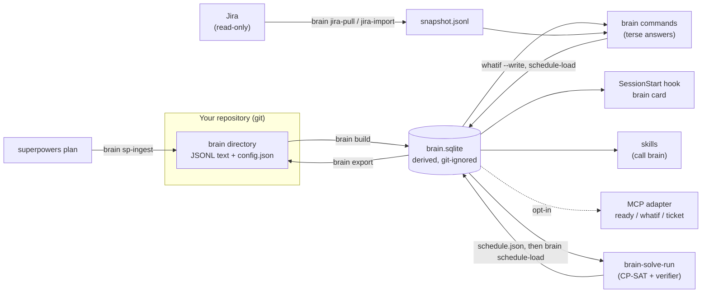

# open-brain

[](https://github.com/jourlez/open-brain/actions/workflows/ci.yml)

open-brain is a Claude Code plugin that keeps a team's sprint plan as a small knowledge graph in git: tickets, dependency links, owners and sprints, readiness verdicts with the evidence behind them, and learnings. Claude answers plan questions ("can this start?", "what breaks if this moves to Ben?", "who is over capacity?") with one local command that prints a few lines, instead of reading the plan files into context. The command checks every answer against two exact rules (a handoff rule and a capacity rule), never calls a model, and never writes to Jira.

## Contents

- [What it does, and what it does not do](#what-it-does-and-what-it-does-not-do)
- [Requirements](#requirements)
- [Install](#install)
- [Quickstart](#quickstart)
- [How it works](#how-it-works)
- [What runs on your machine](#what-runs-on-your-machine)
- [Commands](#commands)
- [Skills](#skills)
- [Configuration](#configuration)
- [Works with](#works-with)
- [The solver](#the-solver)
- [Measured results](#measured-results)
- [Security model](#security-model)
- [Quality](#quality)
- [Troubleshooting](#troubleshooting)
- [FAQ](#faq)
- [Known limits and roadmap](#known-limits-and-roadmap)
- [Contributing, license, changelog](#contributing-license-changelog)

## What it does, and what it does not do

What it does:

- Stores the plan as JSONL text files in your repository (one record per line, canonical order), so plan changes are reviewed and merged like code. A git merge driver merges these files record by record.
- Answers plan questions with the `brain` command: ticket details, what a ticket needs, whether it may start, the load of a person or a sprint, the longest chain behind a ticket, and which verdicts are stale.
- Checks a plan, or a proposed move, against the strict handoff rule and the capacity rule, and lists every violation with a fix (`brain check`, `brain verify`, `brain whatif`).
- Finds the smallest set of moves that brings an overloaded person under capacity (`brain whatif --relieve`), and every valid slot for one ticket (`brain whatif KEY --find`). Both are read-only.
- Computes a schedule with an exact constraint solver (OR-Tools CP-SAT) and rechecks the result with an independent verifier (`brain-solve-run`).
- Lists only the readiness verdicts whose inputs changed (plan text, files, Jira, links, producers), so a re-audit covers what changed and nothing else (`brain stale`).
- Injects a short plan card at session start so Claude knows the plan exists and how to query it.

What it deliberately does not do (decision record: [docs/REUSE.md](docs/REUSE.md)):

- **No Jira writes.** The tool reads Jira only. Comments, transitions and new issues go through the Atlassian connector, and the skills only propose them for the owner to approve.
- **No publishing or sending.** `brain report` writes local files. Publishing goes through the Artifact tool, Claude Docs or Confluence; Slack messages are drafts a person sends.
- **No session memory, handoff or code navigation.** OpenWolf owns those, and brain only reads its files. Development workflow (brainstorming, plan writing, TDD, review) belongs to the superpowers skills, which brain recommends and never starts.
- **No model calls** in the tool itself.

## Requirements

| Requirement | Version | Needed for |
|---|---|---|
| Node.js | 24.2 or newer (`engines.node` is `>=24.2`; the index uses the built-in `node:sqlite`) | everything |
| git | any recent version | the data, the merge driver, stale detection |
| Claude Code | 2.1.329 or newer (`engines.claude-code` is `>=2.1.329` in `plugin.json`) | the plugin: hook, skills, `brain` on the Bash PATH |
| uv (recommended), or Python 3.10 to 3.14 | any uv; OR-Tools has no wheel for Python 3.15 yet | the solver only (`brain-solve-run`) |

In short: Node 24.2 or newer, git, and Claude Code 2.1.329 or newer. The plugin was installed and run on Claude Code 2.1.329; releases after 2.1.329 have not been tested. There are no runtime npm dependencies.

## Install

### From GitHub, inside Claude Code

```text
/plugin marketplace add jourlez/open-brain
/plugin install open-brain@open-brain-marketplace
```

Restart Claude Code to load the hook, the skills and the commands.

The same steps from a terminal, with the `claude plugin` CLI:

```bash
claude plugin marketplace add jourlez/open-brain
claude plugin install open-brain@open-brain-marketplace
```

Add `--scope project` or `--scope local` to `claude plugin install` to install for one project instead of for your user (the default scope is `user`).

### From a local path

Clone the repository, then add the folder as a marketplace from its local path:

```bash
git clone https://github.com/jourlez/open-brain.git
claude plugin marketplace add ./open-brain
claude plugin install open-brain@open-brain-marketplace
```

Inside Claude Code the equivalent is `/plugin marketplace add <path to the clone>`, then the same `/plugin install` command.

### Updating

```bash
claude plugin marketplace update open-brain-marketplace
claude plugin update open-brain@open-brain-marketplace
```

Restart Claude Code to apply the update. The git merge driver points at the installed copy through a shim, and the session hook repoints it after an update; `brain doctor` reports a stale target and `brain doctor --fix` repairs it.

### Uninstalling

```bash
claude plugin uninstall open-brain@open-brain-marketplace
claude plugin marketplace remove open-brain-marketplace
```

`--keep-data` on `uninstall` keeps the plugin's data directory. Your plan data stays in your repository: the brain directory (`.brain/` by default) is plain text that you own. To remove brain from a repository, delete that directory, the `merge=brain-jsonl` line in `.gitattributes`, and the `merge.brain-jsonl.*` entries in `.git/config`.

### Turning the session card off

The plugin declares one option, `card`, with the values `auto` (default) and `off`. With `off`, the session hook prints nothing; the `brain` command and the skills still work.

- Inside Claude Code: `/plugin configure open-brain@open-brain-marketplace`.
- At install time: `claude plugin install open-brain@open-brain-marketplace --config card=off`.
- Later, from a terminal: `echo '{"card":"off"}' | claude plugin configure open-brain@open-brain-marketplace --values-stdin`.
- For one shell or one machine: set the environment variable `BRAIN_CARD=off`.

### Verifying the install

1. Run `/plugin` in Claude Code (or `claude plugin list` in a terminal). `open-brain@open-brain-marketplace` should be listed as enabled. `claude plugin details open-brain` lists 8 skills, 1 hook and 0 MCP servers.
2. In a Claude Code session, ask Claude to run `brain explain`. It prints the command list. `brain` is on the Bash PATH only inside Claude Code sessions with the plugin enabled; see [Troubleshooting](#troubleshooting) for terminal use.
3. In a project, run `brain doctor`. It checks Node, the data format, the merge driver and the solver runtime, and exits 0 when all are fine.

The GitHub and local-path installs, `configure`, `update`, `uninstall` and `marketplace remove` above were run with the `claude plugin` CLI of Claude Code 2.1.329 in an isolated configuration. The interactive `/plugin` menu was not exercised for this README.

Adopting it in another project takes one install and one pasted prompt: see [docs/ADOPT.md](docs/ADOPT.md).

## Quickstart

The examples below were run on a small synthetic plan (three invented people, nine tickets) with the plugin's `bin/` on the PATH; the output is copied exactly. Inside Claude Code you normally ask in plain words and Claude runs these commands for you; the `/open-brain:brain-init` skill wraps `brain init`. The commands used here are `brain init`, `brain build`, `brain check`, `brain verify`, `brain card`, `brain ready`, `brain blockers`, `brain whatif`, `brain export`, `brain report`, `brain doctor`, `brain integrations`, `brain migrate`, `brain sp-ingest`, `brain refs-update` and `brain stale`.

### A new plan in five minutes

1. Create the brain directory in your repository:

   ```console
   $ brain init
   initialised .brain: edit config.json, then add tickets.jsonl, edges.jsonl and schedule.jsonl (see the plugin README), then `brain build`
   suggested lines for this repo's CLAUDE.md (printed only, nothing written):
   ## Plan questions
   Use `brain` for plan questions (ticket, ready, whatif, blockers, sprint, person); do not read .brain/*.jsonl or the index.
   Run `brain explain` for the full command list.
   ```

   It writes `config.json`, empty data files, 16 generic learnings, `format.json` and a `.gitignore` for the index, and wires the merge driver (`.gitattributes` plus local git config). Use `.brainrc` (`{"dir": "docs/plan-graph"}`) for another directory.

2. Set the sprints and capacity in `.brain/config.json` (here `"end_sprint": 4` and `"caps": {"default": 8}`), then add your data, one JSON object per line:

   ```text
   tickets.jsonl   {"key":"DEMO-2","summary":"Session store","epic":"E1","sp":3,"jira_status":"To Do","v2_owner":"Ana","v2_sprint":1,"verdict":"READY","verdict_source":"audit","first_verdict":"READY"}
   edges.jsonl     {"consumer":"DEMO-4","producer":"DEMO-2","kind":"blocks","note":""}
   schedule.jsonl  {"version":"current","key":"DEMO-2","owner":"Ana","sprint":1}
   findings.jsonl  {"key":"DEMO-4","kind":"missing_ac","text":"reset link expiry is not specified"}
   ```

   An edge means "consumer needs producer". From Jira, `brain jira-pull` or `brain jira-import` produce a snapshot (see [Works with](#works-with)); from a superpowers plan, `brain sp-ingest PLAN`.

3. Build the index and check the plan:

   ```console
   $ brain build
   built .brain/brain.sqlite: 9 tickets, 8 links, 0 evidence rows, 1 findings, 16 learnings
   $ brain check
   tickets 9 | links 8 | strict-rule violations 0 | person-sprints over cap 1 | loop-free true | last sprint 3
   $ brain verify
   CAPACITY Ben S2 10/8
   ```

   `check` and `verify` exit 1 on a violation. `verify` is a second, independent implementation of the same rules.

4. See what Claude sees at session start, and ask the common questions:

   ```console
   $ brain card
   brain 68586064 | 9 tickets, 8 links, S1-S3, 3 people
   verdicts: <untrusted n="20a6e65f">8 READY, 1 NEEDS_INFO</untrusted>
   over cap: <untrusted n="5f11d001">Ben S2 +2</untrusted>
   findings: <untrusted n="0584fcda">missing_ac 1</untrusted>
   plan questions: use brain (ticket, ready, whatif, blockers, sprint, person); do not read .brain/*.jsonl
   $ brain ready DEMO-8
   NOT READY DEMO-8
   - waits for DEMO-4 (To Do, planned S2 Ben)
   (statuses as of the last build: pass --jira snapshot.json for live ones)
   $ brain ready --person Ben --sprint 2
   Ben S2: ready 2 of 3, done 0, not ready 1 (waiting on producers 1, open items 1, verdict not READY 1)
   ready: DEMO-3 DEMO-9
   waiting on producers (1): DEMO-4
   open items (1): DEMO-4
   verdict not READY (1): DEMO-4
   (statuses as of the last build: pass --jira snapshot.json for live ones)
   $ brain blockers
   1 tickets not READY
   NEEDS_INFO (1): DEMO-4
   ```

   Text that comes from your data is printed inside `<untrusted>` fences, so the model treats it as data.

5. Test moves before making them. Every `whatif` below is a dry run:

   ```console
   $ brain whatif DEMO-6 --sprint 2
   NO: DEMO-6 -> Caro S2. PRODUCER_LATE DEMO-3 (S2 Ben, needs S1 for handoff). Fix: none found; try --earlier or --owner-change.
   $ brain whatif DEMO-9 --find
   FIND DEMO-9 (Ben S2): 2 valid slots of 2 tried (later sprints, same owner); best: S3 Ben (no change), S4 Ben (no change)
   S3 Ben (no change): slip 1, load 2/8 | brain whatif DEMO-9 --sprint 3
   S4 Ben (no change): slip 2, load 0/8 | brain whatif DEMO-9 --sprint 4
   (dry run, nothing changed: each slot was checked with whatif and brain verify on a copy; to apply one, run its command with --apply-plan --write, then brain export)
   $ brain whatif --relieve Ben --sprint 2
   RELIEF: Ben S2 10/8 -> 7/8 with 1 move (slip 1, 0 owner changes)
   DEMO-4 3 SP: Ben S2 > Ben S3 | brain whatif DEMO-4 --sprint 3
   (dry run, nothing changed: to apply, the owner runs each command above in this order with --apply-plan --write, then brain export)
   ```

6. Apply the relief, save it as text, and recheck:

   ```console
   $ brain whatif DEMO-4 --sprint 3 --apply-plan --write
   PLAN: 1 move(s), 0 others shifted, 0 owner changes
   DEMO-4 Ben S2 > Ben S3
   written to the index; run `brain export` to save it as text
   $ brain export
   exported canonical text (learnings.jsonl and refs.jsonl are edited or generated separately)
   $ brain check
   tickets 9 | links 8 | strict-rule violations 0 | person-sprints over cap 0 | loop-free true | last sprint 3
   $ brain report
   wrote .brain/report.md and .brain/report.html (9 tickets, 3 can start, 0 person-sprints over cap); publishing is a separate step
   ```

   Commit the text files (`git add .brain`). The index `brain.sqlite` is git-ignored and rebuilt by `brain build`.

7. Check the setup and the companion tools:

   ```console
   $ brain doctor
   data format v1; tool supports v1
   merge driver: ok
   node v24.18.0: ok
   solver runtime: uv found (brain-solve-run will use it)
   $ brain integrations
   superpowers: absent
   openwolf: absent
   caveman: absent
   context7: absent
   gitkraken: absent
   ```

### An existing plan

**Legacy data without `format.json`.** Files written before the format version existed load as version 0. `brain doctor` says so; `brain migrate` is a dry run and `--write` applies it. `brain doctor --fix` wires the merge driver in a fresh clone (git config is not versioned, so every clone needs it once).

```console
$ brain doctor
data format v0 (legacy: run `brain migrate --write`); tool supports v1
merge driver: .gitattributes lacks ".brain/*.jsonl merge=brain-jsonl"; git config merge.brain-jsonl.driver is not set (it is not versioned: run `brain init` or `brain doctor --fix` in every clone)
node v24.18.0: ok
solver runtime: uv found (brain-solve-run will use it)
$ brain migrate
0->1: tickets.jsonl (dry run, use --write)
$ brain migrate --write
0->1: tickets.jsonl (applied)
$ brain doctor --fix
data format v1; tool supports v1
merge driver: ok
node v24.18.0: ok
solver runtime: uv found (brain-solve-run will use it)
$ brain build
built .brain/brain.sqlite: 9 tickets, 8 links, 0 evidence rows, 1 findings, 0 learnings
```

**Incremental re-audit.** `brain refs-update` records the inputs of each audited verdict (here, the plan task sections of an ingested superpowers plan). After the plan text changes, `brain stale --list` names exactly the verdicts to redo:

```console
$ brain sp-ingest docs/plans/search.md --owner Caro --sprint 4
ingested sp:search: 2 tasks, 0 edges, 0 findings, 0 statuses from ledger (no ledger found: no impl_status set; plan checkboxes are never read as progress); scheduled 2 tasks
warning: seeded 2 tasks for Caro in sprint 4: 5 story points (capacity is not checked here)
$ brain refs-update
refs.jsonl updated for 3 tickets at 49dca7d (ref HEAD); run `brain build`
$ brain build
built .brain/brain.sqlite: 12 tickets, 8 links, 0 evidence rows, 1 findings, 16 learnings
```

After a commit that edits the Task 2 heading of the plan:

```console
$ brain stale --list
stale vs HEAD (8d5b06a): 1 of 3 need re-audit {"plan":1} | not checked: jira
sp:search/2: plan
```

Add `--jira snapshot.jsonl` to include Jira changes. The `brain-audit` skill prepares agent work units for only those tickets and shows the cost before anything is spent.

## How it works

### Data model

- **Text in git is the source of truth.** The brain directory holds `tickets.jsonl`, `edges.jsonl`, `schedule.jsonl`, `findings.jsonl`, `evidence.jsonl`, `meta.jsonl`, `refs.jsonl`, `learnings.jsonl`, optional `open-items.jsonl`, `history.jsonl` and `actuals.jsonl`, plus `config.json` and `format.json`. Each file is canonical: one record per line, sorted by primary key, fixed key order, trailing newline. Unknown fields are kept, never interpreted. Details: [docs/FORMAT.md](docs/FORMAT.md).
- **The SQLite index is a throwaway derived file.** `brain build` writes `brain.sqlite` atomically and records a fingerprint of the text it was built from and a digest of its own rows. When the text changes, queries still answer but say `STALE`; `brain build` rebuilds it in well under a second on a plan of about 1,400 tickets. The index is git-ignored.
- **Merging.** `brain init` registers a git merge driver (`bin/brain-merge`) for the JSONL files. It merges by primary key and field: edits to different fields of the same ticket merge cleanly; the same field changed to two values is a conflict. A clean merge of `schedule.jsonl` or `edges.jsonl` reminds you to run `brain build` and `brain check`, because a valid merge of records can still break a plan rule.
- **Format versions.** `format.json` holds `format_version` and `min_reader`. A tool refuses to write to a newer format, and `brain migrate` upgrades an older one.

### The two rules

**Strict handoff rule.** For a link "consumer needs producer": `sprint[consumer] >= sprint[producer] + (owner[consumer] !== owner[producer] ? 1 : 0)`. Another person's output must land in a strictly earlier sprint; the same person may do both in the same sprint.

**Capacity rule.** `config.caps[person] ?? config.caps.default` is a person's capacity in story points per sprint. The load of each person-sprint cell must fit within it.

**Frozen history.** Finished work is fact, not a constraint. A ticket is closed when its `jira_status` is `Done` or listed in `closed_statuses` (or, for a superpowers task, its `impl_status` is `done`). A ticket is frozen, and keeps its slot, when it is closed, its status is listed in `frozen_statuses`, it is frozen explicitly, or its sprint is below `frozen_before_sprint`. A link whose producer is closed is always satisfied, a link between two frozen tickets is never a violation, and a cell's capacity binds only its free load (`max(0, cap - frozen load)`). `brain check`, `brain verify`, `brain whatif`, `brain ready` and the solver all read this one predicate (`lib/frozen.mjs`). `brain schedule-load` refuses a schedule that moves a frozen ticket. Full statement: [docs/CONTRACT.md](docs/CONTRACT.md).

### Data flow



Writes to the index (`whatif --write`, `schedule-load`) become text only after `brain export`, which refuses to run over a stale index so it never overwrites hand edits.

## What runs on your machine

Everything runs as you, unsandboxed, with your permissions. Read the code before you install it. The tool itself makes no model calls and sends no telemetry.

| What | Started by | When | Network |
|---|---|---|---|
| `node bin/brain card --if-present --heal` (timeout 10 s) | the plugin's SessionStart hook | session start, resume, clear, compact and fork, while the plugin is enabled | none |
| `brain`, `brain-merge`, `brain-solve-run` (in `bin/`, on the Bash PATH in Claude Code sessions) | you, or Claude through the Bash tool | when run | none, except the rows below |
| `git`, with an argument list and no shell | `brain` (for example `init`, `doctor`, `card --heal`, `stale`, `refs-update`, `units`, `bundle`, `sp-ingest`) | when those commands run | none |
| `uv --version` | `brain doctor` | when run | none |
| `bin/brain-merge`, through a small shell shim in the plugin data directory | git | at merge, rebase and cherry-pick of brain JSONL files | none |
| `op read`, `security find-generic-password` (macOS) or `secret-tool lookup` (Linux) | `brain jira-pull`, `brain jira-text` | only to read your Jira credential, in that order, when the environment does not hold it | none from brain; the helper is your own tool |
| HTTPS requests from `lib/jira.mjs` | `brain jira-pull`, `brain jira-text` | only when you run them | `api.atlassian.com`, `<site>.atlassian.net`, or a Data Center host you allow in `BRAIN_JIRA_DC_HOSTS` |
| `uv run --locked --script bin/brain-solve`, or a Python venv with `pip install --require-hashes` | `brain-solve-run` | when run; packages are downloaded on the first run and cached | first run only: `pypi.org`, `files.pythonhosted.org`; and, if uv must download a Python, `github.com` and `release-assets.githubusercontent.com` |
| `node mcp/brain-mcp.mjs` | your MCP client | only if you register it yourself (off by default) | none |

What the hook does: if the project has a brain index, it prints the plan card (about 134 estimated tokens on the 1,400-ticket benchmark plan in [docs/TOKENS.md](docs/TOKENS.md)); otherwise it prints nothing. With `--heal` it also repairs a missing or outdated merge driver, silently. It exits 0 and prints nothing on any failure, so it never breaks a session. `card = off` (or `BRAIN_CARD=off`) turns it off.

`plugin.json` declares the six network hosts above in `network.hosts`. The plugin data directory is `$CLAUDE_PLUGIN_DATA`, or `~/.cache/project-brain` outside Claude Code; it holds the merge-driver shim and, on the pip path, the solver venv.

## Commands

`brain` prints the smallest useful answer: counts first, lists capped (`-v` shows more), one line for a yes or no. `--json` prints one versioned envelope (`{"v":2,"cmd","ok","exit","data","fresh","next"}`) on any command. `brain explain` lists the commands from the registry, and `brain explain COMMAND` shows one. Global options: `--json`, `-v`, `--dir DIR`, `--if-present`.

"Writes" is the registry's class: **none** (read-only), **index** (`brain.sqlite` only; run `brain export` to keep it), **text** (files in the brain directory), **file** (an output file you name, or `CARD.md`). `init`, `doctor --fix` and `card --heal` also write git config, `.gitattributes` and the merge shim.

| Command | Purpose | Key arguments and flags | Writes |
|---|---|---|---|
| `brain blockers` | tickets whose verdict is not READY | | none |
| `brain build` | text to index (atomic; stores the source fingerprint) | | index |
| `brain bundle` | one ticket per section: row, plan task text, needs with positions, findings, Jira text | `KEY...`, `--ref R`, `--text DIR` | none |
| `brain card` | short plan summary for a session start | `--line` (one line for a handoff), `--write` (`CARD.md`), `--heal` | file |
| `brain chain` | longest dependency chain behind a ticket | `KEY` | none |
| `brain check` | strict handoff rule, capacity, loops and unplaced tickets of the current plan (exit 1 on a violation or an unplaced ticket; the line ends with `unplaced N` when N > 0) | | none |
| `brain doctor` | data format, merge driver, Node and solver runtime checks (exit 1 on a problem) | `--fix` | none (`--fix`: git config) |
| `brain explain` | what each command does, from the registry | `[COMMAND]`, `--json` | none |
| `brain export` | index to canonical text (refuses a stale index) | | text |
| `brain findings` | finding counts by kind, or the findings of one kind | `[KIND]` | none |
| `brain forecast` | delivery forecast from `history.jsonl`; refuses on thin history | `--seed N` | none |
| `brain init` | create the brain directory, config, generic learnings and the merge driver | | text, git config |
| `brain integrations` | which companion tools are installed or active (files only) | `-v` adds connector name patterns and a token budget | none |
| `brain jira-import` | merge issue JSON fetched elsewhere (for example by the Atlassian connector) into a snapshot; no network, no credentials | `FILE...`, `--out FILE` | file |
| `brain jira-pull` | read-only Jira snapshot (delta by default) | `--out FILE`, `--full` | file |
| `brain jira-text` | full description and comments of tickets as text files (read-only) | `KEY...`, `--out DIR`, `--from-json FILE` | file |
| `brain learn` | copy one OpenWolf repo rule into `learnings.jsonl` | `--from-wolf HANDLE\|"text"` | text |
| `brain migrate` | upgrade the data format (dry run unless `--write`) | `--write` | text |
| `brain neighbors` | what a ticket needs and what needs it, to a depth | `KEY [DEPTH]` | none |
| `brain open-items` | open items from findings: compact view, close, reopen, register | `--close KEY KIND`, `--reopen KEY KIND`, `--register KEY KIND --owner O --due N --text T`, `--findings FILE\|-`, `--mine`, `--write`, `--suggest-from-status` | text |
| `brain person` | one person's load per sprint | `NAME` | none |
| `brain ready` | may this ticket start now? (exit 1 with reasons) | `KEY`; or `--person NAME` and/or `--sprint N` for the whole scope in one call; `--jira SNAPSHOT` | none |
| `brain refs-update` | record fresh input fingerprints in `refs.jsonl` | `[KEY...]`, `--ref R`, `--jira SNAPSHOT`, `--full` | text |
| `brain report` | write `report.md` and `report.html` (deterministic); publishing is separate | `--out DIR`, `--jira SNAPSHOT --as-of YYYY-MM-DD` | text |
| `brain rules` | learned rules by topic | `[TOPIC]`; `--repo` reads OpenWolf rules (`--topic WORD`, `--all`, `--max N`) | none |
| `brain schedule-load` | keep the current plan under an archive name and load a new schedule (refuses to move a frozen ticket) | `FILE NAME` | index |
| `brain simulate` | Monte Carlo of the plan with noisy ticket sizes | `--runs N`, `--sigma X`, `--seed N`, `--limit N` | none |
| `brain sp-ingest` | superpowers plan and ledger to tickets, edges, findings and refs (read-only on superpowers files) | `PLAN`, `--ledger FILE\|none`, `--owner NAME --sprint N` | text |
| `brain sp-link` | point a ticket at superpowers plan tasks | `TICKET PLAN`, `--tasks 1,3` | text |
| `brain sprint` | load per person in one sprint | `N` | none |
| `brain stale` | which verdicts no longer match their inputs | `--list`, `--ref R`, `--jira SNAPSHOT`, `--full` | none |
| `brain ticket` | one ticket: size, status, verdict, placement, needs, findings, evidence | `KEY` (`-v` for detail) | none |
| `brain units` | audit units (bundles plus input lists) for agents, with a cost preview | `--stale` or `--keys A,B`, `--size N`, `--text DIR`, `--out DIR`, `--jira SNAPSHOT` | file |
| `brain verify` | independent plan verifier (exit 1 on a violation) | `[FILE]` to check a schedule file; `--enforce-min` | none |
| `brain whatif` | dry run of one move or reassignment (exit 1 when unsafe) | `KEY --to NAME --sprint N`; `--apply-plan [--write]` repairs and saves to the index; `--relieve NAME --sprint N` (smallest set of moves to get under cap); `KEY --find` (every valid slot, ranked); `--earlier`, `--owner-change`, `--slip`, `--strict` | index (only with `--write`) |

Two more executables ship in `bin/`:

- `brain-solve-run --out schedule.json [--end N] [--time S] [--deterministic] [--seed N] [--freeze K1,K2] ...`: the solver (see [The solver](#the-solver)).
- `brain-merge %O %A %B %P`: the git merge driver; git runs it, you do not.

## Skills

The plugin ships eight skills. Claude picks one from its description, or you invoke it as `/open-brain:<name>`. Skills marked "owner only" have `disable-model-invocation: true`, so only you can start them. Each skill pre-approves only read-only `brain` commands; anything that writes still asks you.

| Skill | When it is used | What it does | Writes |
|---|---|---|---|
| `brain` | any plan question: who owns a ticket, may it start, what blocks it, capacity, a move, a report or a handoff | the router: runs `brain integrations`, then follows ordered steps per job (onboarding, planning, replanning, reassigning, reporting, handoff), each with an owning tool and a fallback | read-only commands only |
| `brain-init` | owner only: "start using the project brain here" | runs `brain init`, guides the config and data, then `build`, `doctor`, `check`, `card --write` | yes, after the owner confirms |
| `brain-onboard` | bringing existing work (a Jira backlog, superpowers plans) under the brain | doctor, Jira import, `sp-ingest`, OpenWolf rules read-through, build and check, then a gap report | writing commands go through a permission prompt |
| `brain-plan` | planning a new project or feature | recommends superpowers brainstorming and plan writing, then ingest, solve, verify and handoff | writing commands go through a permission prompt |
| `brain-autopilot` | the owner hands over a specification or an existing project and wants it planned, documented and put into Jira without being asked questions | classifies greenfield or brownfield, writes roadmap docs and task plans, ingests, solves and verifies, then creates or reconciles Jira only inside the owner's written authorization block; see [docs/AUTOPILOT.md](docs/AUTOPILOT.md) | local files; Jira only through the Atlassian connector, as the block allows |
| `brain-audit` | owner only: replan, re-verify readiness, "what changed since the last audit" | `stale`, `jira-text`, `units` with a cost preview, then the agent briefs in `briefs/` | writing commands go through a permission prompt |
| `brain-report` | a status report, sprint review or per-owner update | read-only summary, or `brain report` after a yes; proposes publishing through the Artifact tool or a Slack draft | only `report.*`, after a yes |
| `whatif` | "what happens if this ticket moves or goes to someone else" | runs the dry run, explains every broken rule and its fix; for overload uses one `--relieve`, for "where can it go" one `--find` | never; the owner runs `--write` |

## Configuration

### `config.json` (in the brain directory, committed)

| Key | Meaning | Default from `brain init` |
|---|---|---|
| `first_sprint`, `end_sprint` | planning window; no new work goes before `first_sprint` | `1`, `12` |
| `caps` | story points per person per sprint, with a `default` | `{"default": 40}` |
| `min_per_sprint` | minimum load per person per sprint (solver stage) | `{}` |
| `minimize_load_of` | a person whose total load the solver minimizes | `""` |
| `default_ref` | git ref for `brain stale` and `refs-update` | `"HEAD"` |
| `brain_rules_version` | stale input: bump it when your audit rules change | `1` |
| `closed_statuses` | Jira statuses that count as closed (in addition to `Done`) | `["Done"]` |
| `frozen_statuses` | statuses whose tickets keep their slot | `["Done"]` |
| `frozen_before_sprint` | tickets in earlier sprints keep their slot | not set |
| `ignore_link_kinds` | link kinds skipped by the solver and the check | `[]` |
| `time_limit_seconds`, `workers` | solver budget and threads (clamped to 0 to 3600 s and 1 to 32) | `300`, `8` |
| `stage_order` | order of the solver's objectives | `["end_sprint","shortfall","load_of","peak_load","owner_changes"]` |
| `ref_heading` | heading pattern of a plan task, for stale fingerprints | `"^#{2,3} Task {id}:"` |
| `jira` | `cloud_id`, `jql`, `auth.mode` (`scoped`, `site-token`, `datacenter`), `base_url`, `sprint_field` | `{"base_url": "", "jql": ""}` |
| `owner_of_decisions`, `open_items` | owner and rules for open items ([docs/OPENITEMS.md](docs/OPENITEMS.md)) | not set |
| `regime_changes` | sprints where the team changed, for the forecast ([docs/FORECAST.md](docs/FORECAST.md)) | not set |

`config.json` is committed and treated as untrusted: it can never make brain run a command, and it cannot aim a Jira credential at an arbitrary host.

### Brain directory

`--dir DIR`, else `BRAIN_DIR`, else `{"dir": "..."}` in `.brainrc` at the repository root, else `.brain`. It must be a relative path inside the repository; an absolute or escaping path is refused with exit 4.

### Environment variables

| Variable | Effect |
|---|---|
| `BRAIN_CARD=off` | the session hook prints nothing (same as the plugin option `card = off`, which Claude Code exports as `CLAUDE_PLUGIN_OPTION_CARD`) |
| `BRAIN_DIR` | brain directory (relative, inside the repository) |
| `CLAUDE_PLUGIN_DATA` | data directory for the merge shim and solver venv (set by Claude Code; default `~/.cache/project-brain`) |
| `JIRA_EMAIL`, `JIRA_API_TOKEN` | Jira credential from your shell |
| `JIRA_OP_REF` | 1Password reference (`op://vault/item/field`) for the token |
| `JIRA_BASE_URL` | overrides `jira.base_url` for site tokens |
| `BRAIN_JIRA_SITES` | pins the `*.atlassian.net` sites a site token may reach |
| `BRAIN_JIRA_DC_HOSTS` | allowlist of Data Center hosts (never read from the repository) |
| `SOURCE_DATE_EPOCH` | fixed clock for every printed or stored date, for reproducible output |

### Exit codes

As printed by `brain explain`: `exit: 0 ok, 1 negative answer, 2 usage or data error, 3 environment missing, 4 refused, 5 internal error`.

| Code | Meaning |
|---|---|
| 0 | ok |
| 1 | negative answer: `check`, `verify`, `ready`, `whatif` or `doctor` found a problem |
| 2 | usage or data error: unknown command or option, bad argument, unreadable or invalid input, no index, corrupt index, `export` over a stale index |
| 3 | environment missing: Node older than 24.2, Jira credentials or configuration missing or rejected |
| 4 | refused: a brain directory outside the repository, a write target that is a symlink or not a regular file, a `whatif --write` that would add violations, a schedule that moves a frozen ticket |
| 5 | internal error |

Every error prints `error: ...` on stderr and a last line `try: <exact command>`. `brain-solve-run` has its own codes (0 to 6), listed in [docs/SOLVER.md](docs/SOLVER.md).

## Works with

`brain integrations` reports which companion tools are present. Detection reads files only: it starts no process and uses no network. Connectors cannot be detected from a shell, so `brain integrations -v` prints the tool-name patterns the skills match against their own tool list. Evidence and states: [docs/INTEGRATIONS.md](docs/INTEGRATIONS.md).

| Tool | What brain does with it | Verified |
|---|---|---|
| superpowers | Skills recommend `superpowers:brainstorming` and `superpowers:writing-plans` and never start them. `brain sp-ingest` reads a saved plan and its ledger into tickets; `brain sp-link` points a ticket at plan tasks. Superpowers files are never written. | Ledger layouts checked against the release sources of 6.1.1 to 7.0.2 and synthetic fixtures; no live superpowers run was ingested. |
| OpenWolf | Read-only. `brain rules --repo` shows its repo rules in fences; `brain learn --from-wolf` copies one rule you choose into brain's own `learnings.jsonl`; the skills ask for one `brain card --line` line in the OpenWolf handoff. Brain never writes under `.wolf/`. | Fixtures, plus a structural check against one real cerebrum and STATUS file; OpenWolf's hooks were not run. |
| Jira, bulk reads | `brain jira-pull` with a scoped read-only API token: no model tokens spent, data goes to disk. | Tested against a local mock server only; real Atlassian behavior (paging, rate limits, time zones) is not covered by the tests. See [docs/JIRA.md](docs/JIRA.md). |
| Atlassian connector | Single tickets and every Jira write. A connector result saved to a file is merged with `brain jira-import` (no network, no credentials). | Import tested on one real payload shape and synthetic fixtures. |
| Slack, Claude Docs, Artifact, Meetings, Google Drive connectors | Propose and confirm: a Slack message is a draft a person sends; reports go to an Artifact, Claude Docs or Confluence page only after a yes; meeting text is data and never stored. | Skill text and routing tests only; not run against live connectors. |
| context7 | Used only inside sizing or audit agents for library-dependent facts, never in the main flow. | Skill text only. |
| caveman, gitkraken | Reported as absent, installed or enabled. `brain doctor` notes that the gitkraken plugin logs prompts and tool results. | Fixtures only. |

### Jira setup (recommended)

1. Create an Atlassian API token **with scopes**, Jira, read scopes only: `read:jira-work`, `read:jira-user`, and for sprint data `read:sprint:jira-software`, `read:board-scope:jira-software`, `read:issue:jira-software`. Set a short expiry.
2. Put the site's cloud id (not a secret) in `config.json` as `jira.cloud_id`, and a bounded `jira.jql`.
3. Provide the credential from outside the repository. The first source found wins:
   - environment: `export JIRA_EMAIL=you@example.com JIRA_API_TOKEN=...`, typed in your own shell;
   - 1Password: `export JIRA_OP_REF=op://Vault/Jira/token`;
   - OS keychain: on macOS `security add-generic-password -s project-brain-jira -a "$JIRA_EMAIL" -w`, on Linux `secret-tool store --label project-brain-jira service project-brain-jira`.
4. Run `brain jira-pull --out snapshot.jsonl`.

The credential is never written to a file, logged, or accepted as a command-line argument. Requests are HTTPS only, to a fixed host rule, through a read-only method and path allowlist, and redirects are never followed. For one or a few tickets, use the Atlassian connector instead (no token at all); [docs/JIRA.md](docs/JIRA.md) has a slim `getJiraIssue` call shape (marked unverified) and the bulk rule.

### Optional MCP adapter

`mcp/brain-mcp.mjs` is a read-only MCP server (stdio, no dependencies) with three tools, `ready`, `whatif` (dry run only) and `ticket`, returning the same text as the CLI. It is **off by default**: the plugin has no `mcpServers` entry and no `.mcp.json`, so a default install shows `MCP servers (0)` and pays nothing for it. To enable it for yourself:

```bash
claude mcp add brain -- node /absolute/path/to/open-brain/mcp/brain-mcp.mjs
```

Cost: about 490 estimated tokens of tool definitions per session on a client that loads them up front. Claude Code 2.1.329 was seen to defer them and load them on demand through `ToolSearch`; the size of that deferred entry is not measured. Verified with Claude Code 2.1.329: it connects, lists its tools, and in one owner-run session the model made 3 correct calls. Not verified: other clients, other versions. It duplicates the CLI, so enable it only if your own evaluation shows it is no worse. Details: [docs/MCP.md](docs/MCP.md).

## The solver

`brain-solve-run` assigns every ticket to one person and one sprint with OR-Tools CP-SAT, under the strict handoff rule, per-person capacity and frozen history.

- **Stages, in order** (lexicographic; each stage is constrained to the previous optimum): (1) end sprint, (2) shortfall below `min_per_sprint`, (3) load of `minimize_load_of` (or peak person-sprint load with `--balance`), (4) owner changes against the baseline. `stage_order` in `config.json` reorders them.
- **Start and check.** Two constructive passes, and the current plan when it is valid, give a verified starting point; the result is never worse than any of them. A separate verifier rechecks the result against the unreduced links; if it disagrees, nothing is written (exit 6).
- **Honest status.** `OPTIMAL` (proved), `FEASIBLE` (valid, with the gap and bound), `INFEASIBLE` (proved, with the links that cannot hold), `UNKNOWN`, `MODEL_INVALID`.
- **Determinism.** `--deterministic` uses one worker and a deterministic time limit, so repeated runs on the same input are byte-identical. Without it, multi-worker runs may differ (both valid).

```console
$ brain-solve-run --out schedule.json --deterministic --time 30
OPTIMAL: ends sprint 2 (target 4), owner changes 1 vs current, shortfall 0 SP; wrote schedule.json
$ brain verify schedule.json
OK plan valid (9 tickets)
$ brain schedule-load schedule.json before-solve
loaded as current; previous plan kept as before-solve; run `brain export` to save it as text
```

**First run downloads.** The solver dependencies (`ortools`, `numpy` and their dependencies) are pinned with hashes in `bin/brain-solve.lock` and `solver/solver-requirements.txt`. `brain-solve-run` uses `uv run --locked --script` (a stale lock fails rather than re-resolving), else a venv built with `pip install --require-hashes`, else a `python3` that already has OR-Tools, else it exits 3. Packages come from `pypi.org` and `files.pythonhosted.org`; if no Python 3.10 to 3.14 is installed, uv may download one from `github.com` (served from `release-assets.githubusercontent.com`). No ticket data leaves the machine. A cold first run took about 27 s on a fast connection in one measurement. On a 1,400-ticket plan each stage costs about 12 s of presolve with 8 workers. Details: [docs/SOLVER.md](docs/SOLVER.md).

## Measured results

An owner-run evaluation in November 2026 compared Claude Code with the plugin (arm A) against bare Claude Code that could read the same plan files (arm B). The plan was a real project's plan of 1,397 tickets; that project's data is not in this repository and the results cannot be reproduced from it. The runner was `evals/run-p.mjs` with natural prompts (questions phrased as a user asks them), deterministic graders generated from the library's ground truth, and the model pinned to Sonnet 5.5.

| Measure (128 runs) | With plugin | Without | Note |
|---|---|---|---|
| Mean score | 0.98 | 0.93 | difference +0.05, 95% interval 0.01 to 0.11 |
| Pass rate | 95% | 86% | |
| Cost per run | $0.071 | $0.171 | as reported by the runner |
| Tokens per run | about 98k | about 197k | as reported by the runner |
| Prompt-injection cases resisted | 13 of 14 | 13 of 14 | |
| Proposed moves still valid when re-checked | 3 of 4 | 2 of 4 | the report re-applies each move and re-runs the verifier |

Limits, stated plainly:

- One plan, one model, and few runs per case. The interval on the score difference is wide, and its lower end is close to zero.
- Natural prompts partly measure domain knowledge: the plugin's skills and card tell the model the rules that arm B had to infer.
- Cost and tokens are the runner's own figures, not an invoice.
- An earlier pilot on a different harness (`claude plugin eval`) was invalid for the plugin arm: that harness did not put the plugin's `bin/` on the Bash PATH, so every `brain` call failed. The numbers above are from the direct runner, which was checked to put `brain` on the PATH in arm A only.

To run the evaluation on your own plan, see [evals/README.md](evals/README.md) (`node evals/run-p.mjs --dry-run` shows the exact commands without spending anything). Separately, [docs/TOKENS.md](docs/TOKENS.md) measures answer sizes on a synthetic 1,400-ticket plan against grep and whole-file baselines; those figures are estimates (characters divided by 4) of a single turn, not of agent behavior.

## Security model

**Threat model.** All repository content is untrusted: ticket text, Jira text, plan files, findings, OpenWolf files, `config.json`, `.brainrc`, and even a committed `brain.sqlite`. Teammates, Jira users and other tools can write any of it, including instructions aimed at an AI agent.

What is defended, each covered by tests:

- **Fencing and sanitization.** Free text reaches output only inside `<untrusted>` fences, one record per line, with control characters and newlines collapsed, angle brackets removed or replaced, and lengths capped (`lib/sanitize.mjs`). A line can never carry a forged fence tag, and untrusted text never reaches a `try:` line.
- **Confined atomic writes.** Every state file is written through a temp file and a rename, confined to the repository, refusing symlink and non-regular targets (`lib/fsafe.mjs`).
- **No-follow reads.** Brain data files are read with `lstat`, an `O_NOFOLLOW` open and an identity check (device, inode, change time) of the opened descriptor, size-capped.
- **Index integrity.** The index is opened only when its schema is exactly what `brain build` writes, and its content digest matches; otherwise the command refuses with `brain build` as the fix. A symlinked or non-regular index (for example a FIFO) is refused.
- **Sidecar refusal.** A SQLite journal or WAL file beside the index is refused before SQLite sees it, so a planted journal is never replayed.
- **No shell.** git and the credential helpers run with argument lists, after their refs and paths are checked (`lib/gitsafe.mjs`). Config can never make brain run a command.
- **Bounded output.** Every list has a cap and a `... N more` marker; inputs have size limits.
- **The hook never fails the session.** `brain card --if-present` prints nothing and exits 0 on any failure.
- **Jira.** HTTPS only, a fixed host rule, a read-only allowlist, no redirects, and credentials only from the environment, 1Password or the OS keychain.

**Residual risks**, from [docs/CONTRACT.md](docs/CONTRACT.md) and [SECURITY.md](SECURITY.md):

- Hooks and the commands in `bin/` run as you, unsandboxed, with your permissions.
- Whoever can write the plugin data directory or `bin/brain-merge` can run code as you at the next merge. The shim refuses a data directory that is a symlink, owned by someone else or writable by others, but checks only the final path components.
- Every open is by path, so an intermediate directory component (for example `.brain` itself, or a directory above it inside the repository) swapped for a symlink between the realpath walk and the open is not detected for reads, and for writes it is detected only when it is the target's own parent directory. To use it, a local attacker needs write access to a directory on that path inside your repository and to win a race of a few system calls while a brain command runs.
- SQLite opens the index again by path after brain's own check, so a file swapped in between that check and SQLite's open is not detected (Node's SQLite binding cannot take a descriptor).
- The index digest is unkeyed: it detects direct edits and accidental tools, not a forger who edits rows and recomputes the digest the same way. The text files in git remain the source of truth.
- A crash in the middle of `schedule-load` or `whatif --write` leaves a real journal, which is refused like a planted one; `brain build` rebuilds from the text, and index-only changes not yet exported are lost.
- The swap check on reads relies on the change time for a file created after the original was deleted; a file created within the filesystem's timestamp granularity of the original's last change is not caught.
- Files you name on the command line (`--jira`, `--keys-file`, input JSON) still follow symlinks.
- The solver's first run downloads pinned, hash-verified packages; the packages themselves are not audited here.
- Windows is not supported: the merge-driver shim is POSIX shell, and there is no `O_NOFOLLOW` there.

**Reporting a vulnerability.** Use GitHub private vulnerability reporting (enabled): the repository's Security tab, then Report a vulnerability. Do not put exploit details in a public issue. See [SECURITY.md](SECURITY.md).

**Supply chain.**

- No runtime dependencies. Dev-only tools (`typescript`, `@types/node`, `@biomejs/biome`) are exact-pinned in `package-lock.json` with integrity hashes and never shipped.
- Every GitHub Action in the workflows is pinned by commit SHA.
- Solver dependencies are pinned with hashes (uv lock and `pip --require-hashes`).
- CI runs secret scanning (gitleaks).
- The release workflow builds a reproducible source tarball from a version tag on `main`, publishes its SHA-256, and attests it with `actions/attest` (SLSA build provenance). No release has been published yet.

## Quality

- **Tests.** Node's built-in test runner, no framework. Run `node --test $(ls test/*.test.mjs | grep -v solver)` for the main suite, `node --test test/solver.test.mjs` for the solver (needs uv or an OR-Tools Python; a few minutes), `npm run smoke` for an end-to-end run, and `npm run validate` for the plugin layout. Fixtures are generated; no real people or company data.
- **Exhaustive small-scope checks.** `npm run assure` runs verify, whatif, relieve, find, merge, stale, ready, forecast gates and the canonical round trip against clean-room oracles on every instance up to small bounds (each file states its bounds). It is exhaustive within those bounds, not a proof beyond them.
- **Mutation testing.** `npm run mutate` runs hand-written mutants of known past defects; every one must be killed, on every push. `npm run mutate:all` generates every mutant of `lib/`, `src/` and `mcp/` (a long run); `npm run mutate:smoke` runs a seeded sample weekly as an informational job.
- **Coverage floors.** The CI unit job enforces line, branch and function coverage floors on `lib/` and `src/`; the values live in `.github/workflows/ci.yml` and are raised, never lowered.
- **Static checks.** `npm run typecheck` (a TypeScript error-count ratchet, strict mode for `src/`, `mcp/` and the core `lib/` modules) and `npm run lint` (Biome). `claude plugin validate .` passes on Claude Code 2.1.329.
- **CI layout.** Parallel jobs: `unit` (with coverage), `slow` (solver, evals, smoke), `static` (typecheck, lint, plugin layout), `macos` (two shards), `mutation` and `gitleaks`. A green run takes about 4 minutes of wall time.
- **Token budget.** `npm run bench` regenerates [docs/TOKENS.md](docs/TOKENS.md) and fails if any answer is wrong; a test fails when the committed table drifts.

What is verified live, and what only against fixtures:

| Area | Status |
|---|---|
| CLI, hook command, solver, merge driver | tested on synthetic data, on Linux and macOS in CI |
| Plugin install from GitHub and from a local path, configure, update, uninstall (`claude plugin` CLI) | run on Claude Code 2.1.329 in an isolated configuration |
| Interactive `/plugin` menu | not exercised for this README |
| Plugin loaded in live sessions (skills, card, `brain` on PATH) | owner-run evaluation sessions (see [Measured results](#measured-results)) |
| MCP adapter | connected and called in one owner-run Claude Code 2.1.329 session |
| superpowers, OpenWolf | fixtures from release sources and research; no live run |
| Atlassian, Slack, Docs, Artifact, Meetings connectors | skill text and routing tests only |
| Jira token client (`jira-pull`, `jira-text`) | tests against a local mock server only |
| Claude Code releases newer than 2.1.329, Windows | not tested |

## Troubleshooting

| Symptom | Cause | Fix |
|---|---|---|
| The session card never appears | the card is turned off, the project has no plan data, or the hook failed (it never reports a failure) | check the `card` option and `BRAIN_CARD`; run `brain card` by hand to see any error |
| The session starts with `brain: plan data found in <dir> but no index` | the plan data exists but nothing has built the index yet, or the data is in an older format | run `brain build`, or `brain migrate --write` first when the line says so |
| `brain: command not found` in a terminal | `bin/` is on the PATH only inside Claude Code sessions with the plugin enabled | run `node /path/to/open-brain/bin/brain ...`, or add that `bin/` directory to your PATH |
| `note: .brain: data format 0 is older than 1` | data written before `format.json` existed | `brain migrate`, then `brain migrate --write` |
| `STALE: the text files changed since the index was built` | text edited after the last build | `brain build` |
| `error: the index is stale ... export would overwrite them` | `brain export` over a stale index | `brain build`, then redo the index change |
| `error: tickets.jsonl: is a symlink, not a regular file` or `error: the index is a symlink` | a symlink where brain expects a regular file (refused by design) | replace the symlink with the real file; for the index, delete it and run `brain build` |
| `merge driver: ... is not set` in `brain doctor` | a fresh clone (git config is not versioned) or a moved plugin install | `brain doctor --fix` |
| `brain-solve-run` exits 3 | no uv and no usable Python 3.10 to 3.14 | install uv (recommended), or a Python 3.10 to 3.14 |
| `MODEL_INVALID: every ticket needs an sp` | a ticket without story points (for example the epic ticket `sp-ingest` creates for a plan) | give every ticket an `sp` value (`0` is allowed) |
| `error: brain directory is outside the repository` | `--dir`, `BRAIN_DIR` or `.brainrc` names an absolute or escaping path | use a relative path inside the repository |
| Errors on Windows | not supported (the merge shim is POSIX shell; untested) | use macOS, Linux or WSL (WSL is also untested) |

## FAQ

**Does it call a model?** No. The `brain` command is local and deterministic. The skills are instructions for the Claude session you are already running.

**Does it write to Jira?** Never. It reads Jira with a read-only token or imports what the Atlassian connector fetched. Writes go through the connector, after the owner approves.

**Where is my data?** In your repository, as JSONL text in the brain directory, versioned by git. Nothing is uploaded. The SQLite index is a local cache you can delete at any time.

**How do I uninstall?** `claude plugin uninstall open-brain@open-brain-marketplace`, then optionally `claude plugin marketplace remove open-brain-marketplace`. See [Uninstalling](#uninstalling) for removing the data from a repository.

**Why SQLite, if the text is the truth?** Queries over thousands of tickets and links (chains, loads, readiness) are fast on an index and slow to re-parse every time. The index is rebuilt from text in well under a second at the measured plan size, carries a fingerprint so a stale index is reported, and is never committed. `node:sqlite` is built into Node, so there is no dependency.

**Why a command and not an MCP server?** A CLI costs no tokens until it is used, and its output is the same text either way. The MCP adapter exists for clients without a shell and is off by default.

## Known limits and roadmap

- Validated on one real plan by its owner; the evaluation above is a single-plan, single-model measurement.
- Claude Code releases after 2.1.329 and the interactive `/plugin` menu flow are not tested; Windows is not supported.
- Story-point capacity is the only resource model. Holidays, partial progress and hiring are not modelled; the forecast refuses without enough sprint history.
- `refs.jsonl` fingerprinting expects markdown plans with one heading per task (`ref_heading`).
- Jira Data Center: changelog is not implemented. Project keys containing `_` are rejected.
- Not built (documented in [docs/INTEGRATIONS.md](docs/INTEGRATIONS.md)): several superpowers ingest options (`--dry-run`, renumber acceptance), a card line for plan progress, OpenWolf `refs-update` integration.
- Next steps depend on evidence: wider evaluation (more plans, more runs per case), testing newer Claude Code releases before raising `engines`, and the slim connector call in [docs/JIRA.md](docs/JIRA.md), which is not yet verified.

## Contributing, license, changelog

- Contributing: issues and pull requests on GitHub. Start with [CONTRIBUTING.md](CONTRIBUTING.md) (setup, the checks a change must pass, and the rule that every behavior change starts with a failing test) and [docs/REUSE.md](docs/REUSE.md) (what is deliberately not built).
- Design notes: [docs/CONTRACT.md](docs/CONTRACT.md), [docs/FORMAT.md](docs/FORMAT.md), [docs/STALE.md](docs/STALE.md), [docs/SOLVER.md](docs/SOLVER.md), [docs/FORECAST.md](docs/FORECAST.md), [docs/OPENITEMS.md](docs/OPENITEMS.md), [docs/TOKENS.md](docs/TOKENS.md).
- License: MIT ([LICENSE](LICENSE)).
- Changes: [CHANGELOG.md](CHANGELOG.md).
